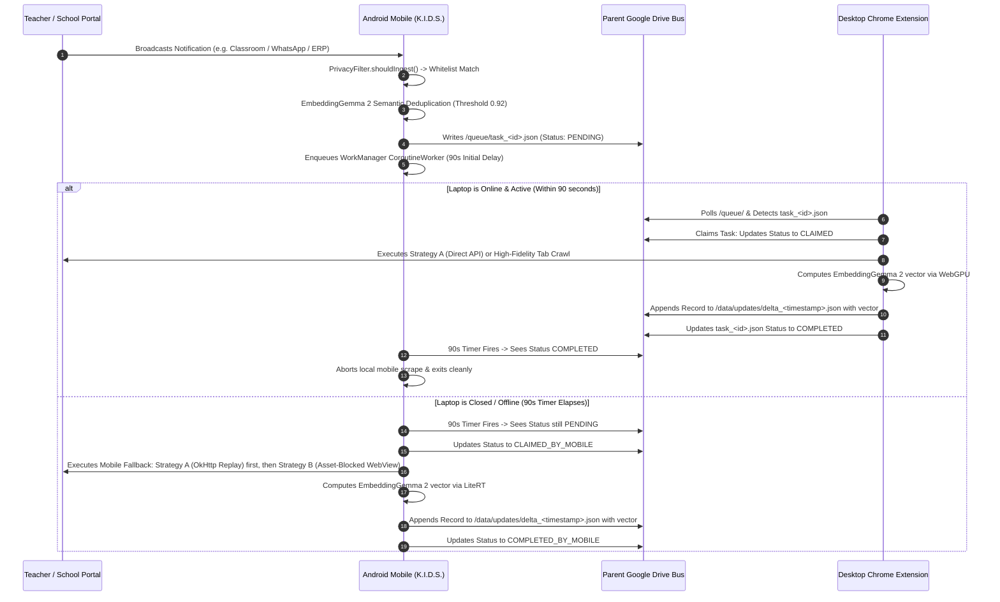
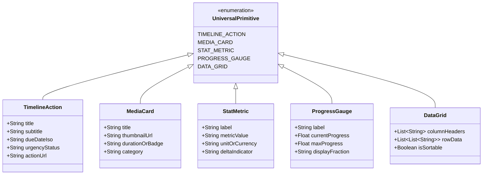
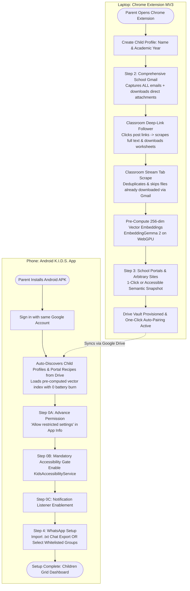
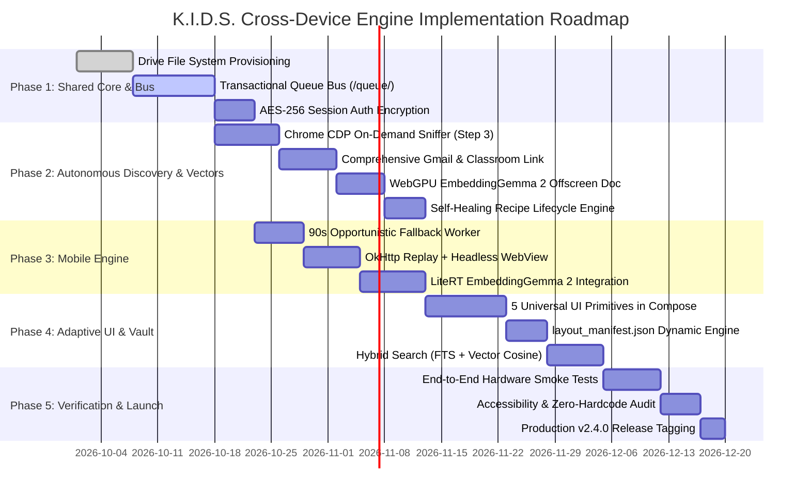

# Product Requirements Document (PRD) & Technical Specification
## Decentralized Cross-Device Scraping, Autonomous API Discovery & Adaptive UI Engine (K.I.D.S. Ecosystem)

**Document Version:** `2.8.0-PROD`  
**Standard Compliance:** September 2026 Standard (Kotlin K2, Jetpack Compose Material 3, Chrome MV3, LiteRT, WebGPU / ONNX Runtime Web, Google Drive REST v3, Chrome Prompt API)  
**System Classification:** Ambient, Zero-Backend ($0 Cloud Infrastructure), 100% On-Device Symmetrical AI  
**Authoritative Repositories:**
- **Mobile Collector Core:** [c:/K.I.D.S](file:///c:/K.I.D.S) (Android Companion, Room FTS4, ML Kit OCR, Kotlin Graphify, Accessibility Service, LiteRT EmbeddingGemma 2)
- **Desktop Extension & Portal Engine:** [C:/Users/daars/.gemini/antigravity/scratch/school-mcp-sync-engine](file:///C:/Users/daars/.gemini/antigravity/scratch/school-mcp-sync-engine) (Chrome MV3, DevTools CDP Interceptor, WebGPU EmbeddingGemma 2 Offscreen Document, Comprehensive Gmail & Classroom Stream Crawler, Dual-Surface UI)

---

## 1. Executive Summary & Product Vision

### 1.1 The Core Problem
Modern parents and digital guardians face an increasingly fragmented educational and developmental landscape. Critical notices, assignments, circulars, fee deadlines, progress reports, and media activities are siloed across incompatible, walled-garden applications:
1. **Google Classroom & School Gmail:** Often locked behind strict Enterprise/Education domain security policies where third-party OAuth apps encounter `access_not_configured` or require domain administrator whitelist approval. Parents receive a deluge of emails—some containing circulars with attachments, and others containing notification links to Classroom posts where the actual instructions and worksheets are hosted.
2. **Proprietary School ERPs (CampusCare, Toddle, Edunext):** Session-authenticated Single Page Applications (SPAs) that do not expose public APIs, requiring daily manual parent logins.
3. **Informal Parent Communication Channels (WhatsApp, Telegram):** Hundreds of daily chat messages containing scattered circular photos, homework reminders, and PDF attachments mixed with parent chatter.
4. **Autonomous Digital Activities (YouTube Kids, Duolingo, Roblox):** Separate activity logs and metrics that are difficult to track cohesively.

Existing scraping and aggregation products rely on hosted cloud servers, headless browser farms (Puppeteer/Playwright in AWS/GCP), external vector databases, and complex middleware. This traditional architecture introduces fatal liabilities: recurring cloud infrastructure costs ($15–$50/user/mo), severe privacy risks from transmitting sensitive student records and session cookies through third-party servers, and continuous breakage whenever portals alter their frontend HTML structure.

### 1.2 The K.I.D.S. Solution
The **Kids Intelligent Dashboard System (K.I.D.S.)** delivers an autonomous, zero-cost, serverless cross-device data harvesting and intelligence ecosystem. 

**Core Architectural Shift (Zero-Middleware, Unified Drive Vault & Symmetrical Vector Engine):**  
All external middleware and Model Context Protocol (MCP) servers are **completely removed**. The entire system operates as a **Self-Contained Data Hub & Output Synthesis Engine**:
1. All educational data, circulars, direct email attachments, Classroom worksheets, and portal metrics are scraped into **ONE central place in the parent's Google Drive** (`K.I.D.S. Data/`).
2. **Comprehensive Gmail Ingestion with Classroom Deep-Link Resolution:** Captures **ALL emails** in the student/school mailbox (circulars, fee reminders, principal letters, bus updates) with direct attachment downloads, AND automatically follows deep links inside Classroom notification emails to scrape full post text and attached assignments directly from Classroom.
3. Both **Android Mobile (Jetpack Compose)** and **Desktop (Chrome Extension)** consume this unified Google Drive Vault directly to render rich, interactive dashboards.
4. **Symmetrical Cross-Device Embedding Architecture (EmbeddingGemma 2):** 
   - Both Desktop Chrome (via **WebGPU Offscreen Document**) and Android Mobile (via **LiteRT**) run the **exact same EmbeddingGemma 2 model** producing identical 256-dimensional Matryoshka Representation Learning (MRL) embeddings.
   - Desktop pre-computes vector embeddings during Phase 1 bulk crawls and persists them into `notices_index.json` on Google Drive, completely relieving the phone's battery of embedding generation overhead.
5. **Desktop Search Architecture Guardrail:** **Gemini Nano is strictly NOT used for searching files or records across Google Drive on Desktop.** Drive search on Desktop is powered by a high-speed, deterministic **Hybrid Search Engine** (Google Drive REST API + Local IndexedDB FTS + EmbeddingGemma 2 Vector Cosine Similarity). Gemini Nano on Desktop is reserved strictly for local text transformation, recipe synthesis, and summarization of pre-retrieved text. On Android, search is powered by native **Room SQLite FTS4 + LiteRT EmbeddingGemma 2**.

```
┌────────────────────────────────────────────────────────────────────────┐
│                        LAPTOP: CHROME EXTENSION (MV3)                  │
│                                                                        │
│  [Child & Portal Onboarding]       [On-Demand Portal Sniffer (Step 3)] │
│  (Desktop-First Profile Setup)     (User-triggered on active tab)      │
│              │                                     │                   │
│              ▼                                     ▼                   │
│  [Step 2: Comprehensive Gmail]     [DevTools CDP & Session Capture]    │
│  • Captures ALL school emails      (Cookies/Tokens captured on-demand) │
│  • Downloads direct attachments                    │                   │
│  • Classroom emails -> clicks link                 │                   │
│    scrapes full post & assignments                 │                   │
│  • Scrapes Course Stream tab                       │                   │
│    (skips files downloaded via Gmail)              │                   │
│              │                                     │                   │
│              ▼                                     ▼                   │
│  [EmbeddingGemma 2 on WebGPU] ──► Pre-computes 256-dim MRL embeddings  │
│  (Runs via Chrome Offscreen Doc)   Saves vectors to Drive notices_index│
│              │                                     │                   │
│              └──────────────────┬──────────────────┘                   │
│                                 │                                      │
│                  Writes Recipes & Baseline History                     │
└─────────────────────────────────┼──────────────────────────────────────┘
                                  │
                                  ▼
┌────────────────────────────────────────────────────────────────────────┐
│             SHARED DECENTRALIZED BUS: PARENT'S GOOGLE DRIVE            │
│                                                                        │
│  • /config/recipes/recipe_<id>.json (Selectors & API contracts)        │
│  • /config/auth/session_auth.json (AES-256 Cookies, Storage, UA)       │
│  • /queue/task_<timestamp>.json (Transactional Lock Bus)               │
│  • /data/baseline/history_<id>.json (Historical data & Watermarks)     │
│  • /data/updates/delta_<timestamp>.json (Incremental records)          │
│  • /ui/layout_manifest.json (Dynamic dashboard configuration)          │
│  • K.I.D.S. Data/{AcademicYear}/{ChildName}/ (Master Vault)            │
│      ├── notices.jsonl & MASTER_DIGEST.md                              │
│      ├── notices_index.json (Pre-computed 256-dim Vector Embeddings)   │
│      ├── _system/knowledge_graph.json & graph.html                     │
│      └── attachments/ (OCR-indexed circulars & homework PDFs)          │
└─────────────────────────────────▲──────────────────────────────────────┘
                                  │
                                  │ Reads Queues / Writes Deltas / Syncs
                                  │
┌─────────────────────────────────┴──────────────────────────────────────┐
│                    MOBILE: ANDROID APPLICATION (K.I.D.S.)              │
│                                                                        │
│  [One-Click Google Auto-Pair]  ──► Auto-discovers Profiles & Portals   │
│                │                   Reuses pre-computed vectors (0 OOM) │
│                ▼                                                       │
│  [Step 0 Mandatory Gate]       ──► Restricted Settings + Accessibility │
│                │                                                       │
│                ▼                                                       │
│  [NotificationListenerService] ──► Real-time push intercepted          │
│                │                                                       │
│                ▼                                                       │
│  [Opportunistic Fallback]      ──► Strategy A (OkHttp API Replay)      │
│                                    Strategy B (Asset-Blocked WebView)  │
│                │                                                       │
│                ▼                                                       │
│  [Local ML Kit OCR + Room FTS] ──► Offline OCR & Jetpack Compose UI   │
└────────────────────────────────────────────────────────────────────────┘
```

---

## 2. Strategic Invariants & Safety Guardrails

All code and architecture implementations must strictly adhere to the following six non-negotiable architectural invariants:

### 2.1 Zero-Backend Invariant ($0 Cloud Infrastructure Cost)
Student data, homework, circulars, session tokens, and analytics MUST NEVER be routed through, mirrored to, or persisted on external cloud servers, proxy relays, hosted databases, or third-party web scrapers. All network transactions occur strictly between the local device and the parent's authenticated personal Google Drive Vault.

### 2.2 Restricted Privacy Scope (`drive.file`)
The OAuth scope requested by both Android and Desktop applications MUST strictly be:
- `https://www.googleapis.com/auth/drive.file` (Only grants access to files and directories created by K.I.D.S.).
- `https://www.googleapis.com/auth/spreadsheets` (For appending rows to the notice tracking sheet).
Full Google Drive scopes (`drive` or `drive.readonly`) are strictly prohibited.

### 2.3 Symmetrical On-Device AI & Search Engine Guardrails
- **Symmetrical Vector Model (EmbeddingGemma 2):**
  - **Desktop Chrome:** Runs quantized EmbeddingGemma 2 (INT8/INT4, $\sim 150\text{ MB}$) in a dedicated Chrome **Offscreen Document** accelerated by **WebGPU** (sub-15ms inference).
  - **Android Mobile:** Runs the identical EmbeddingGemma 2 model via **Google LiteRT** (RAM $< 200\text{ MB}$).
  - Both platforms operate in the identical 256-dimensional Matryoshka Representation Learning (MRL) coordinate space. Desktop pre-computes vectors during historical ingest; mobile reuses them without burning battery.
- **Desktop Search Architecture Guardrail:**
  - **Gemini Nano is strictly NOT used for searching files or records in Google Drive.** Google Drive searches are executed via a **Hybrid Search Engine** combining:
    1. Google Drive REST API query engine (`q=...`).
    2. Local client-side IndexedDB Full-Text Search (FTS).
    3. In-memory cosine similarity over local EmbeddingGemma 2 vectors.
  - **Gemini Nano Role:** Chrome Built-in AI (`window.ai.languageModel` / Gemini Nano via Prompt API) is reserved strictly for: (1) Synthesizing dynamic CSS/ARIA selectors during user inspection, (2) Normalizing raw unformatted chat turn strings into structured JSON, and (3) Generating short narrative summaries over pre-retrieved hybrid search results.
- **Android Search Engine:** **Room SQLite FTS4** (sub-50ms keyword matching) + **LiteRT EmbeddingGemma 2** (cosine similarity $> 0.92$ deduplication and semantic routing).

### 2.4 Strict Memory-Boundary Privacy Filtering
Push notifications intercepted via Android `NotificationListenerService` MUST be evaluated against child whitelist registries and package filters BEFORE any disk persistence or network transmission. Non-educational notifications, personal chats, OTPs, and banking alerts must be dropped immediately with zero disk persistence and zero telemetry logging.

### 2.5 Universal Design & WCAG 2.1 AA/AAA Compliance
- All interactive touch targets enforce a minimum bounding box of **$48\text{dp} \times 48\text{dp}$**.
- Contrast ratios must meet or exceed **$4.5:1$** for standard body text and **$7:1$** for headings.
- Brand Typography: **Kanit** for Display/Headings, **Poppins** for Body and UI controls.
- Brand Palette: Deep Navy (`#1A365D`), Amber Orange (`#ED8936`), Light Slate (`#E2E8F0`), Off-White (`#F7FAFC`), Surface White (`#FFFFFF`).

### 2.6 Zero-Hardcoding Quality Gate
Static pixel coordinates, hardcoded academic years (e.g. `"2026-2027"`), arbitrary loop counts (e.g. `MAX_PAGES = 60`), and developer handles are strictly banned. All builds must pass `python scripts/verify_zero_hardcode.py` prior to compilation. Necessary protocol exemptions require documented human approval annotations.

---

## 3. User Personas & Real-World Use Cases

### 3.1 Primary Personas
- **The Multi-Kid Working Parent (e.g., Anvesha & Atharva's Parent):** Manages two children attending different schools (Anvesha at SJBHS Grade 8, Atharva at MyGlobal School Grade 3). Needs unified visibility without switching between 4 apps and 12 WhatsApp groups.
- **The Non-Technical Guardian:** Grandparents or non-technical parents who cannot configure web scrapers, regex rules, or OAuth developer consoles.
- **The AI-First Power Parent:** Uses native hybrid search (keyword + semantic vector) and on-device conversational summaries within the app to query daily schedules, exam timetables, and homework deadlines.

### 3.2 Supported Data Domains & Target Platforms
| Platform Domain | Target Entities Extracted | Ingestion Mechanism |
| :--- | :--- | :--- |
| **School Gmail (Comprehensive)** | **ALL school emails:** circulars, fee reminders, bus notifications, newsletters, principal letters, teacher emails. Direct attachments (PDFs, images) downloaded to Drive. Vectorized via EmbeddingGemma 2. | Desktop Chrome Extension Gmail Crawler (scans all inbox threads with school/teacher labels). |
| **Google Classroom** | Coursework, assignments, due dates, attached PDFs/worksheets, teacher stream posts. Vectorized into 256-dim embeddings. | **Phase 1 (Desktop):** Follows deep links inside Classroom notification emails -> scrapes full assignment text and downloads attached files. Then crawls Stream tab (skipping files downloaded via Gmail).<br>**Phase 2 (Mobile):** Push notification listener & delta fetch. |
| **School ERPs (CampusCare, Toddle, Edunext)** | Homework cards, official circulars, exam schedules, fee payment receipts, attendance percentages. | **Step 3 On-Demand Capture:** Parent navigates to functionality tab in Chrome and triggers extension capture. |
| **WhatsApp School Groups** | Teacher notices, timetable images, circular PDFs, assignment deadlines, holiday announcements. | **Phase 1:** Upload chat export (.txt/.zip) OR scan web/app chat.<br>**Phase 2:** Ambient Android push notification listener + ML Kit OCR. |
| **Educational Media (YouTube Kids)** | Watch history, video titles, channel names, watch duration, educational topic tags. | Desktop Chrome Extension passive tab extraction. |
| **Gamified Learning (Duolingo, Roblox)** | Daily streak counters, XP points, curriculum completion %, Robux ledger balances. | Desktop on-demand extension capture (Step 3). |

---

## 4. Dual-Phase Ingestion & Opportunistic Synchronization Engine

Data capture is bifurcated into two operational tiers to balance device capabilities, conserve mobile battery, and maximize data completeness:



### 4.1 Phase 1: Bulk Baseline Capture (Desktop-Bound)
- **Execution Scope:** Restricted strictly to the Chrome Extension on desktop. Prohibited on Android to prevent battery throttling, memory kills, and high cellular data usage.
- **Traversal Mechanics:**
  - Automated pagination, multi-tab traverses, and virtual scrolling to exhaust historical records (e.g. back to academic term start).
  - Pre-resolves and indexes authenticated download URLs for circular PDFs, timetables, and worksheet attachments without forcing binary blobs onto phone storage.
  - **Vector Embedding Generation:** As records are harvested, the extension passes text chunks to the **WebGPU EmbeddingGemma 2 Offscreen Document**, generating 256-dimensional MRL embeddings written directly into `notices_index.json` on Drive.
- **Cryptographic Sync Watermark:**
  - Emits `/data/baseline/history_<id>.json`.
  - Watermark includes: `last_synced_timestamp`, `highest_numerical_id`, and a SHA-256 Bloom filter of `seen_entity_hashes`.

### 4.2 Phase 2: Incremental Delta Capture (Opportunistic Hybrid)
- **Event Trigger:** Incoming notification intercepted by Android `NotificationListenerService`.
- **Scoped Execution:** Targeted single-item fetch (fetching only the newly broadcasted assignment or deep-link ID) rather than crawling historical lists.
- **Deduplication:** The notification payload is vectorized via **EmbeddingGemma 2** on LiteRT. If cosine similarity with an item captured in the last 6 hours exceeds `0.92`, the capture is aborted.
- **Watermark Reconciliation:** Items are verified against the Drive watermark. If $\text{Item ID} \le \text{Watermark}$ and entity hash is present, the item is dropped; otherwise, it appends to `/data/updates/delta_<timestamp>.json` and advances the watermark.

### 4.3 Cross-Device Transactional Lock Bus Protocol
Google Drive coordinates cross-device tasks via transactional JSON files:

```json
{
  "taskId": "task_20261015_083201_492",
  "childName": "Anvesha",
  "packageName": "com.google.android.apps.classroom",
  "notificationTitle": "New Assignment: Mathematics Chapter 4",
  "notificationText": "Due Tomorrow at 5:00 PM. Complete exercises 1-10.",
  "targetUrl": "https://classroom.google.com/c/ODU1NzM5/a/NTg2MTky/details",
  "status": "PENDING",
  "createdAt": "2026-10-15T08:32:01.492Z",
  "claimedBy": null,
  "claimedAt": null,
  "completedAt": null
}
```

**State Machine:**
1. `PENDING`: Created by Android `NotificationListenerService`.
2. `CLAIMED`: Claimed by Desktop Chrome Extension within the 90-second window.
3. `COMPLETED`: Desktop finished capture, computed embedding, wrote delta to Drive, and updated task state.
4. `CLAIMED_BY_MOBILE`: Desktop was offline; Android WorkManager claimed fallback execution.
5. `COMPLETED_BY_MOBILE`: Android executed OkHttp replay or headless WebView capture and computed vector locally.
6. `AUTH_EXPIRED`: Authentication cookies expired; triggers re-authentication banner on dashboard.

---

## 5. Autonomous "API-First" Discovery & Dual-Strategy Extraction

```
                         [ User Visits Portal in Chrome ]
                                        │
                                        ▼
                         [ Passive Network Sniffer (CDP) ]
                                        │
                 Is structured JSON returned from an internal API?
                                        │
                       ┌────────────────┴────────────────┐
                       │                                 │
                    [ YES ]                            [ NO ]
                       │                                 │
                       ▼                                 ▼
          ┌───────────────────────────┐     ┌───────────────────────────┐
          │   Strategy A: Direct API  │     │   Strategy B: DOM Scrape  │
          │                           │     │                           │
          │ • Captures endpoint URL   │     │ • Gemini Nano ARIA recipe │
          │ • Replays auth headers    │     │ • Asset-blocked WebView   │
          │ • Immune to DOM changes   │     │ • Evaluates rendered DOM  │
          │ • Sub-300ms execution     │     │ • High resilience ladder  │
          │ • < 15MB RAM footprint    │     │ • 15s hard timeout        │
          └───────────────────────────┘     └───────────────────────────┘
```

### 5.1 Strategy A: Autonomous Direct API Replay (Primary Execution)
1. **Passive Sniffing:** The desktop Chrome Extension passively monitors network requests via `chrome.debugger` (Chrome DevTools Protocol).
2. **Payload Heuristic:** When an HTTP response completes with `Content-Type: application/json`, a heuristic evaluator scans the body for domain entity signatures:
   - Arrays of objects containing keys: `id`, `title`, `name`, `due_date`, `assignment`, `circular`, `score`, `marks`, `attachments`.
3. **Endpoint Recipe Generation:** Once confirmed, the extension extracts:
   - Request URL pattern and query parameters.
   - Required headers (`Authorization: Bearer ...`, `X-CSRF-Token`, custom cookies).
   - Expected response JSON path mapping.
   - Emits `/config/recipes/recipe_<id>.json`.
4. **Cross-Platform Replay:**
   - **Desktop:** Extension replays the request using native `fetch()`.
   - **Android:** Executes the HTTP call via `OkHttp` using cached credentials from `session_auth.json`.
   - **Performance:** Execution latency $< 300\text{ms}$, memory footprint $< 15\text{MB}$, 100% immune to DOM redesigns.

### 5.2 Strategy B: Dynamic DOM Extraction & Selector Synthesis (Fallback)
Used when the target portal is Server-Side Rendered (SSR) HTML or uses binary protocols (Protobuf, gRPC-Web):
1. **Visual Selector Synthesis:**
   - Chrome Built-in AI (**Gemini Nano**) inspects the DOM hierarchy of clicked elements and generates an **Attribute Hierarchy Ladder**:
     1. Dedicated test identifiers: `[data-testid]`, `[data-id]`.
     2. ARIA roles and labels: `[role="article"]`, `[aria-label]`.
     3. Semantic HTML5 tags: `<time>`, `<article>`, `<h3>`.
     4. Class names stripped of dynamic CSS-in-JS hashes (regex `^[a-zA-Z0-9_-]{8,}$` removed).
2. **Android Headless WebView Sandbox:**
   - Android evaluates the selector recipe inside an off-screen `WebView`.
   - **Asset Blocking:** Intercepts and blocks images, fonts, media, and third-party trackers via `WebViewClient.shouldInterceptRequest`:
     ```kotlin
     override fun shouldInterceptRequest(view: WebView, request: WebResourceRequest): WebResourceResponse? {
         val url = request.url.toString().lowercase()
         if (url.endsWith(".png") || url.endsWith(".jpg") || url.endsWith(".woff2") || 
             url.endsWith(".css") || url.contains("google-analytics")) {
             return WebResourceResponse("text/plain", "UTF-8", ByteArrayInputStream(ByteArray(0)))
         }
         return super.shouldInterceptRequest(view, request)
     }
     ```
   - **Lifecycle Guards:** Main-thread instantiation, strict 15-second timeout, immediate `webView.destroy()` upon data extraction.

### 5.3 Self-Healing Recipe Lifecycle
- If an active recipe yields 0 items following a valid notification trigger, the recipe status is updated to `STALE` in Google Drive.
- Upon the parent's next desktop Chrome session, Gemini Nano analyzes the updated DOM structure, computes selector diffs, and synthesizes an updated recipe without user intervention.

### 5.4 Comprehensive School Gmail Ingestion Engine (100% Mailbox Coverage)
Educational notices, fee invoices, bus delay updates, holiday announcements, and event circulars are delivered via regular school emails from school administration, principals, class coordinators, and transport teams (e.g. `@globalschoolsfoundation.org` or custom school domains). Limiting ingestion solely to Classroom notification emails causes parents to miss critical non-Classroom communications. Step 2 therefore establishes a **Full-Mailbox Educational Ingestion Engine**:

```
[ Connected School Gmail Account ] ──(Multi-Account Prefix /u/0/, /u/1/)
                 │
                 ▼
  [ Full-Mailbox Traversal & Cursor Watermark ]
  • Scans all incoming threads & labeled school folders
  • Handles 1,600+ email volumes via cursor pagination
  • Filters by school domains, teacher names, and academic timestamps
                 │
        ┌────────┴────────────────────────┐
        │                                 │
 [ Regular School Email ]      [ Classroom Notification Email ]
 (Circulars, Fees, Bus)        (Material, Announcement, Assignment)
        │                                 │
        ▼                                 ▼
 • Downloads direct attachments   • Follows Deep Link to Classroom Post
   (.pdf, .docx, .xlsx, .jpg)     • Scrapes full post body & instructions
 • Local OCR on attachments       • Downloads attached worksheets/files
 • Classifies category            • Cleans format badges (.pdf_PDF -> .pdf)
        │                                 │
        └────────────────┬────────────────┘
                         │
                         ▼
        [ Symmetrical Vector Embedding (EmbeddingGemma 2) ]
        • Computes 256-dim MRL vector via WebGPU Offscreen Doc
        • Appends record to notices.jsonl & MASTER_DIGEST.md
        • Saves vector to notices_index.json on Google Drive Vault
```

1. **Authentication & Multi-Account Session Alignment:**
   - Evaluates the authenticated parent/student Google session.
   - Automatically detects and binds to the student's multi-account prefix (e.g. `/u/0/`, `/u/1/`, `/u/2/`) matching the school domain profile (e.g. Global Schools Foundation `atharva.chaodha...`).
2. **Mailbox Traversal, Adaptive Batching & Checkpointing:**
   - Evaluates all emails across inbox threads and school label folders (e.g. `atharva.cwig680...`).
   - **Adaptive Pacing & Rate Limit Avoidance:** Processes emails in adaptive chunks of 25–50 messages with a 500ms–1s dynamic jitter delay between requests to prevent Google API rate limiting (HTTP 429) across high-volume mailboxes ($1{,}600+$ emails).
   - **Resilient Checkpointing:** Writes state checkpoints to `sync_timeline.log` after every batch, enabling the crawl to be safely paused, resumed, or recovered across extension restarts without duplicating network calls.
   - Employs a persistent timestamp watermark (`last_gmail_synced_at`) so subsequent background sweeps only inspect newly received messages.
3. **Dynamic Academic Grade Discovery & Previous-Class Boundary Termination:**
   - **Zero-Hardcoding Guarantee:** The crawler NEVER hardcodes class labels (e.g. `"3B"`, `"2B"`). Instead, it discovers the active class dynamically and derives the historical boundary mathematically.
   - **1st-Email Class Signature Identification:**
     - When inspecting emails in descending chronological order (newest first), the crawler locates the very first Google Classroom notification email (`<no-reply@classroom.google.com>`).
     - It parses the course name directly from the card header or snippet (e.g. `Grade 3B CAIE 2026-27`).
     - Applying dynamic pattern extraction `/(?:Grade|Class|Year|Std|Standard)?\s*(\d+)\s*([A-Za-z])?/i`, it extracts:
       - Current Numeric Grade $G_{\text{current}}$ (e.g. `3`).
       - Current Division / Section $S_{\text{current}}$ (e.g. `"B"`).
       - Current Academic Year $Y_{\text{current}}$ (e.g. `"2026-2027"` or `"2026-27"`).
   - **Dynamic Historical Stop Condition ($G_{\text{previous}} = G_{\text{current}} - 1$):**
     - The crawler calculates the prior grade threshold: $G_{\text{previous}} = G_{\text{current}} - 1$ (e.g. $3 - 1 = 2$, identifying the boundary for Grade 2 / `2B`).
     - As the crawler traverses backward in time through inbox history:
       - Every Classroom notification email is evaluated against the course signature.
       - The moment an email is encountered whose course signature indicates a grade $\le G_{\text{previous}}$ (e.g. `Grade 2B`, `Grade 2`, `Class 2`, or an academic year prior to $Y_{\text{current}}$), the engine identifies that it has reached the **Academic Class Transition Boundary**.
       - **The crawl terminates immediately at this boundary.**
       - Prevents ingesting obsolete homework and circulars from previous years into the current child's active academic profile, saving Google Drive storage and avoiding dashboard clutter.
4. **Direct Attachment Harvesting & OCR Indexing:**
   - Extracts all binary attachments (`.pdf`, `.jpg`, `.png`, `.docx`, `.xlsx`, `.pptx`).
   - Downloads files directly through the authenticated browser context and persists them into `K.I.D.S. Data/{AcademicYear}/{ChildName}/attachments/`.
   - Executes local OCR indexing on image circulars and multi-page PDFs via streaming `PdfRenderer`, indexing extracted text into the notice record.
5. **School Domain Whitelisting & Noise Elimination:**
   - Extracts: Sender Display Name, Sender Email Address, Subject, Sent Timestamp, Thread ID, and clean Plain-Text Body.
   - **Automated Domain Whitelist:** Whitelists the active school domain (e.g. `@globalschoolsfoundation.org` derived from student email) and educational keywords (`circular`, `fee`, `transport`, `bus`, `exam`, `timetable`, `principal`, `homework`).
   - **Automated Noise Elimination:** Silently filters out and drops non-educational noise (Google security alerts, password resets, promotional notifications).
   - Classifies messages into domain tags:
     - `CLASSROOM_NOTIFICATION`: Senders ending in `(Classroom)` / `(Cl...)` or `no-reply@classroom.google.com`.
     - `SCHOOL_CIRCULAR`: Official school circulars, principal bulletins, academic policies.
     - `FEE_REMINDER`: Invoices, fee due dates, payment receipts.
     - `TRANSPORT_BUS`: Bus route numbers, pick-up/drop delay alerts, driver contacts.
     - `EVENT_ANNOUNCEMENT`: Competitions, annual functions, sports days, celebrations.
     - `GENERAL_NOTICE`: Unclassified educational notices.

### 5.5 Google Classroom Notification Deep-Link Follower & Worksheets Harvester
Classroom notification emails contain only a teaser summary, whereas the full teacher instructions, scoring rubrics, submission deadlines, and worksheet attachments reside on `classroom.google.com`. The extension implements an autonomous **Deep-Link Resolution Engine**:

1. **Automation Execution Environment & User Tab Isolation:**
   - **Primary Execution (Internal API):** The extension first attempts direct internal Classroom Web API calls via `fetch` with authenticated credentials from the background service worker, avoiding any tab creation.
   - **Fallback Isolation Window:** If internal API calls require full DOM rendering or encounter CSRF hurdles, automation runs in a **dedicated separate Chrome window** where no user tabs are allowed other than what is required for this tool, isolating automation completely from the parent's active browsing.
2. **Pattern Matching & Post Classification:**
   - Matches Classroom email subject patterns:
     - `New material: "<Title>"` $\rightarrow$ Type: `MATERIAL`
     - `New assignment: "<Title>"` $\rightarrow$ Type: `ASSIGNMENT`
     - `New announcement: "<Title>"` $\rightarrow$ Type: `ANNOUNCEMENT`
     - `Returned: "<Title>"` $\rightarrow$ Type: `GRADED_RETURN`
     - `Due soon: "<Title>"` $\rightarrow$ Type: `DEADLINE_ALERT`
   - Extracts Course Name directly from email snippet or header (e.g. `Grade 3B CAIE 2026-27`).
   - Extracts target Classroom URL:
     - Material: `https://classroom.google.com/c/{courseId}/m/{materialId}`
     - Assignment: `https://classroom.google.com/c/{courseId}/a/{assignmentId}`
     - Stream Announcement: `https://classroom.google.com/c/{courseId}/p/{announcementId}`
3. **Session-Aware Deep-Link Navigation:**
   - Rewrites URLs with the active user prefix (e.g. `https://classroom.google.com/u/0/c/{courseId}/m/{materialId}`) to prevent unauthorized session bounce or domain permission errors.
   - Inspects the target post without disrupting the parent's active browser windows.
4. **Full Content & Rubric Extraction:**
   - Scrapes the full, unabridged instructions body, teacher notes, points, and exact due date/time.
   - Maps detected due dates directly into `TIMELINE_ACTION` primitives with color-coded urgency badges (`< 24h` Crimson, `< 48h` Orange).
5. **Attached Worksheets & As-Is Archival Invariant:**
   - **Credential Wall Prevention:** Simply saving web links is strictly prohibited because opening them requires student school-domain credentials that parents' personal phones do not possess.
   - **Original Format Archival:** All attached worksheets and materials (PDFs, images, Google Docs, Sheets, Slides) are downloaded or copied **as-is in their original format** without conversion, directly into the parent's personal Google Drive vault (`K.I.D.S. Data/{AcademicYear}/{ChildName}/attachments/`).
   - Cleans format badges from titles via `cleanAttachmentTitle` (e.g. `Writing Skills - Marks Bifurcation.pdf_PDF` $\rightarrow$ `Writing_Skills_Marks_Bifurcation.pdf`).
6. **Unified Record Synthesis:**
   - Merges the deep-linked post body, submission deadline, canonical `classroomPostId`, and downloaded worksheet references directly into the primary notice entry in `notices.jsonl`.
   - Computes 256-dimensional vector embedding over combined text via WebGPU EmbeddingGemma 2.

### 5.6 Google Classroom Stream Tab Backfill & Cross-Source Deduplication
To guarantee 100% data completeness for announcements posted directly to Classroom that did not generate an email:

1. **Autonomous Course Stream Crawl:**
   - Navigates to `/c/{courseId}` in the isolated background window.
   - Performs automated virtual scroll down to the beginning of the academic term (April cutoff).
   - Expands truncated text blocks and evaluates "+N more" overflow modal dialogs.
2. **Canonical Post ID & File ID O(1) Deduplication Invariant:**
   - Every ingested notice stores canonical `classroomPostId` (`/m/{id}`, `/a/{id}`, `/p/{id}`) and attachment `driveFileId`.
   - When traversing the Course Stream, the crawler performs an instant $O(1)$ lookup against already-indexed `classroomPostId` entries.
   - If a post or worksheet was already harvested via the Gmail Deep-Link Follower, scraping and downloading are completely skipped.
   - Prevents duplicate Drive storage consumption and duplicate notifications on mobile.

---

## 6. Decentralized Google Drive Storage Architecture

All state, configurations, queues, datasets, and diagnostic logs are persisted under a unified root directory in the parent's Google Drive:

```
G:\My Drive\K.I.D.S. Data\
├── _system\
│   ├── config\
│   │   ├── recipes\
│   │   │   ├── recipe_classroom.json
│   │   │   └── recipe_entab_erp.json
│   │   └── auth\
│   │       └── session_auth.json (AES-256 Encrypted)
│   ├── queue\
│   │   └── task_20261015_083201_492.json
│   └── logs\
│       ├── sync_timeline.log
│       └── diagnostic_snapshot.json
├── ui\
│   └── layout_manifest.json
└── {AcademicYear}\ (e.g. 2026-2027)
    └── {ChildName}\ (e.g. Anvesha, Atharva)
        ├── notices.jsonl (Append-Only Event Stream)
        ├── notices_index.json (Pre-computed 256-dim Vector Embeddings & Metadata)
        ├── MASTER_DIGEST.md (Human-Readable Markdown Digest)
        ├── graph.html (Interactive Force-Directed Knowledge Graph)
        ├── _system\
        │   └── knowledge_graph.json (GraphRAG Structure)
        └── attachments\
            ├── circular_sports_day_2026.pdf
            └── homework_math_oct15.jpg
```

### 6.1 Artifact Specification Matrix

| File Path | Format | Synchronization Cadence | Security / Privacy Invariant |
| :--- | :--- | :--- | :--- |
| `/config/recipes/*.json` | JSON | Emitted on new portal onboarding; updated on healing. | No user credentials. Pure declarative schema rules. |
| `/config/auth/session_auth.json` | Encrypted JSON | Synced upon login on Desktop; read by Android fallback. | **AES-256-GCM encrypted** using key derived from parent Google ID. |
| `/queue/task_*.json` | JSON | Emitted per notification; deleted 24h after completion. | Transient transactional lock bus. |
| `/ui/layout_manifest.json` | JSON | Re-evaluated on every delta ingestion. | Determines dynamic widget hierarchy on mobile and web. |
| `notices.jsonl` | JSONL | Append-only per notice ingestion. | Core raw text record with OCR extraction and source tags. |
| `notices_index.json` | JSON | Updated on batch sync. Contains 256-dim MRL embeddings. | Symmetrical vectors usable by both Chrome and Android. |
| `MASTER_DIGEST.md` | Markdown | Recompiled on ingestion batch. | Human-readable weekly/monthly overview with active links. |
| `knowledge_graph.json` | JSON | Rebuilt by Kotlin Graphify Engine. | Graph nodes (subjects, teachers, dates) and semantic edges. |
| `graph.html` | Standalone HTML | Rebuilt alongside knowledge graph. | Offline interactive visual graph with zero external CDN deps. |
| `sync_timeline.log` | Rolling Text | Real-time append. | Privacy-sanitized diagnostic execution trace. |

---

## 7. Universal Schema-Driven UI & The 5 Atomic Primitives

The presentation layer makes zero assumptions regarding data schemas. All extracted data streams—academic assignments, YouTube Kids watch history, Roblox balances, or fee circulars—are classified by an on-device layout evaluator into **5 Universal UI Primitives**:



### 7.1 Primitive Definitions & Detection Heuristics

#### 1. `TIMELINE_ACTION`
- **Data Signature:** Contains future date strings, ISO timestamps, or due-date keywords (`due_date`, `submission_deadline`, `test_date`, `valid_until`).
- **Rendering:** Jetpack Compose countdown deadline cards with high-contrast urgency pills:
  - `< 24 hours`: Deep Crimson (`#9B2C2C`) blinking urgent tag.
  - `< 48 hours`: Amber Orange (`#ED8936`) action tag.
  - `> 48 hours`: Slate Grey (`#475569`) standard schedule card.

#### 2. `MEDIA_CARD`
- **Data Signature:** Contains image or thumbnail URLs (`.jpg`, `.webp`, `ytimg.com`, `drive.google.com/thumbnail`) alongside a title and category.
- **Rendering:** Responsive media grid with cached image thumbnails, duration tags, and source attribution badges.

#### 3. `STAT_METRIC`
- **Data Signature:** Scalar numeric values, currency symbols, or game units (`coins`, `pts`, `hrs`, `XP`, `₹`, `$`).
- **Rendering:** Hero KPI metric tiles featuring bold Kanit numbers, unit subtext, and trend arrows.

#### 4. `PROGRESS_GAUGE`
- **Data Signature:** Fractions (e.g. `"3400/5000"`, `"12/15 chapters"`) or percentage strings (`"85%"`).
- **Rendering:** Animated linear progress bars or circular radial progress rings displaying completion percentages.

#### 5. `DATA_GRID` / `EVENT_STREAM`
- **Data Signature:** Uniform multi-column tables or timestamped chronological text records.
- **Rendering:** Sortable, searchable data tables or expandable chronological card streams with full-text search.

### 7.2 Dynamic UI Composition (`layout_manifest.json`)
Native renderers (Jetpack Compose on Android, Web Components in Chrome) parse `layout_manifest.json` dynamically:
```json
{
  "updatedAt": "2026-10-15T08:35:00.000Z",
  "activeChild": "Anvesha",
  "pinnedAlerts": [
    {
      "primitive": "TIMELINE_ACTION",
      "priority": 1,
      "data": {
        "title": "Mathematics Ch 4 Homework",
        "dueDateIso": "2026-10-16T17:00:00Z",
        "urgency": "URGENT_24H"
      }
    }
  ],
  "sections": [
    { "id": "academics", "title": "Academic Tasks", "primitive": "TIMELINE_ACTION" },
    { "id": "metrics", "title": "Performance & Attendance", "primitive": "STAT_METRIC" },
    { "id": "circulars", "title": "Recent Circulars", "primitive": "DATA_GRID" }
  ]
}
```

---

## 8. Symmetrical Vector Architecture & Hybrid Desktop Search

### 8.1 Symmetrical Cross-Device Vector Engine (EmbeddingGemma 2)
Both platforms are unified under an identical on-device vector representation:

```
┌────────────────────────────────────────────────────────────────────────┐
│                        CHROME EXTENSION (MV3)                          │
│                                                                        │
│   [Chrome Offscreen Document] (WebGPU / WASM execution provider)       │
│   • Model: Quantized EmbeddingGemma 2 (INT8/INT4 ~150MB)              │
│   • Performance: Sub-15ms vectorization via WebGPU                     │
│   • Output: 256-dimensional MRL Embedding Vectors                      │
│   • Pre-computes vectors during Phase 1 crawl and writes to Drive      │
└───────────────────────────────────┬────────────────────────────────────┘
                                    │
                                    ▼ Shared Coordinate Space
                    Google Drive notices_index.json
                                    ▲ (256-dim MRL Vectors)
                                    │
┌───────────────────────────────────┴────────────────────────────────────┐
│                        ANDROID MOBILE RUNTIME                          │
│                                                                        │
│   [Google LiteRT Runtime] (< 200MB RAM Heap footprint)                 │
│   • Model: Quantized EmbeddingGemma 2                                  │
│   • Zero Battery Burn: Directly reads pre-computed vectors from Drive  │
│   • Local Vectorization: Only runs on incoming Phase 2 notifications   │
└────────────────────────────────────────────────────────────────────────┘
```

### 8.2 Desktop Hybrid Search Engine (FTS + Vector Cosine Similarity)
> **Authoritative Specification:** Gemini Nano (via Chrome Prompt API) is an on-device Small Language Model (SLM) with a fixed $\sim 4\text{k}$ token context window. **It CANNOT and MUST NOT be used to search, query, or crawl files in Google Drive.**

Instead, Desktop Search across the Google Drive Vault is implemented as a **Tri-Layer Hybrid Search Engine**:
1. **Google Drive REST API Query Engine (Remote Vault Search):**
   - Directly executes targeted queries using Drive's indexed metadata parameters:
     ```javascript
     const query = `'${parentFolderId}' in parents and fullText contains '${sanitizedSearchTerm}' and trashed = false`;
     const response = await gapi.client.drive.files.list({ q: query, fields: 'files(id, name, mimeType, webViewLink, createdTime)' });
     ```
   - Delivers sub-150ms exact keyword matching across document titles, text files, and Drive OCR-indexed PDFs.
2. **Local Client-Side Full-Text Search (IndexedDB FTS / MiniSearch):**
   - The Chrome Extension maintains an inverted full-text search index in local browser `IndexedDB`, mirrored from `notices_index.json` and `notices.jsonl`.
   - Tokenizes notice titles, full body texts, sender names, and OCR transcripts.
   - Provides instantaneous ($< 15\text{ms}$) prefix search, fuzzy matching, and multi-field filtering directly in the desktop dashboard without network roundtrips.
3. **Local Semantic Vector Search (EmbeddingGemma 2 on WebGPU):**
   - When a parent searches natural questions (*"What are the track and field requirements?"*), the query is vectorized in $< 15\text{ms}$ via EmbeddingGemma 2 in the Offscreen Document.
   - Computes cosine similarity against stored 256-dim notice embeddings in IndexedDB, matching semantically relevant circulars (e.g. *"Annual Athletics Meet Circular"*) even when keywords don't match.
4. **Appropriate Role for Gemini Nano on Desktop:**
   - Gemini Nano is utilized **strictly post-retrieval** on small, focused text payloads:
     - **Dynamic Selector Synthesis:** Inspects DOM element hierarchies during Step 3 to generate ARIA/CSS extraction rules.
     - **Chat Normalization:** Classifies raw conversational chat messages into structured JSON schemas.
     - **Grounded Result Summarization:** Takes the top $2\text{--}3$ pre-retrieved hybrid search results and generates a concise 2-sentence conversational answer with explicit citations.

### 8.3 Mobile Search Engine: Room SQLite FTS4 + LiteRT EmbeddingGemma 2
On Android, search operates completely offline:
- **Room SQLite FTS4 Table (`FtsNotice`):** Provides sub-50ms deterministic keyword and phrase matching across local notices.
- **EmbeddingGemma 2 on LiteRT:** Computes vector embeddings for incoming notifications for cosine deduplication (threshold $> 0.92$) and semantic intent routing.
- **Google ML Kit OCR:** Extracts text from local images and PDFs in $\sim 200\text{ms}$ with zero cloud API usage.

---

## 9. Centralized Vault Architecture & In-App Output Synthesis

> **Architecture Decision:** Model Context Protocol (MCP) servers and external middleware are **completely dropped**. All data is scraped into a **single, unified vault in Google Drive**, and all outputs (dashboards, digests, knowledge graphs) are built directly from that repository.

### 9.1 The Single-Place Drive Vault Model
All captured notices, circulars, PDFs, homework descriptions, pre-computed vector embeddings, and portal metrics are consolidated under:  
`G:\My Drive\K.I.D.S. Data\{AcademicYear}\{ChildName}\`

This eliminates:
- Google Apps Script deployment maintenance, quota exhaustion, and execution timeouts.
- Third-party MCP proxy servers, localhost bridges, or JSON-RPC networking failures.
- Token refresh hassles and cross-origin permission hurdles.

### 9.2 In-App Native UI as Primary Output
Rather than routing data through an AI agent tool call, the parent consumes all intelligence directly through **native, high-fidelity app interfaces**:
1. **Android Companion App:** Full Jetpack Compose Material 3 UI featuring the 5 Universal Primitives, countdown badges, full-text FTS4 search, and force-directed knowledge graph visualization.
2. **Desktop Chrome Extension Dashboard:** Full-screen dashboard inside Chrome rendering the exact same Drive data, providing large-screen management, circular viewing, and quick filter pills.
3. **Embedded Hybrid Search Bar:**
   - Desktop search is powered by **Drive REST API + IndexedDB FTS + EmbeddingGemma 2 Vector Similarity** (fast, deterministic, semantic, zero hallucination).
   - Android search is powered by **Room SQLite FTS4 + LiteRT EmbeddingGemma 2**.
   - Queries like *"Show me Atharva's upcoming tests"* or *"Find circulars about Sports Day"* execute instantaneously against the local sync mirror.

### 9.3 Drive-Native Portable Artifacts (Auto-Generated)
On every sync cycle, the engine autonomously compiles portable, standalone artifacts directly into the Drive folder so the parent can inspect them from any browser or device:
- `MASTER_DIGEST.md`: A beautifully formatted weekly markdown digest categorizing tasks by subject, urgency, and source.
- `graph.html`: A self-contained, offline HTML file rendering a D3.js force-directed knowledge graph connecting subjects, teachers, deadlines, and circular files.
- `notices.jsonl`: An append-only event stream preserving raw timestamps, sender handles, and OCR extractions.
- `Google Sheets Sync`: Automatically appends new notices as rows to the parent's *K.I.D.S. School Notices* spreadsheet.

---

## 10. End-to-End Component & Extension Screen Specifications

### 10.1 Android Mobile Collector ([c:/K.I.D.S](file:///c:/K.I.D.S))
- **`KidsNotificationListenerService`:** 24/7 background listener intercepting push notifications from Google Classroom, WhatsApp, and school ERPs. Evaluates whitelist filters, extracts extras (`android.title`, `android.text`, `android.picture`), and triggers Room persistence.
- **Opportunistic Mobile Fallback Engine:**
  - When a notification arrives, Android creates `/queue/task_<id>.json` (`PENDING`) and schedules a 90-second deferred worker.
  - If the desktop laptop is offline after 90 seconds, Android wakes up and executes:
    1. **Strategy A (Direct OkHttp API Replay - Primary):** Replays the portal's JSON endpoint using cached session cookies from `/config/auth/session_auth.json`. Sub-300ms, $<15\text{MB}$ RAM, zero DOM overhead.
    2. **Strategy B (Asset-Blocked Headless WebView - Fallback):** If the portal requires dynamic DOM evaluation (complex SPA/SSR), loads the URL in an off-screen WebView with images, CSS, fonts, and trackers blocked. Executes within a 15s hard timeout and immediately destroys the WebView.
- **`DownloadFolderObserver` / `MediaStoreObserver`:** ContentObserver monitoring `Download/` and WhatsApp Media directories for incoming PDFs and circular images.
- **`OcrProcessor`:** Google ML Kit Text Recognition with streaming `PdfRenderer`. Recycles Bitmaps immediately to maintain $< 100\text{MB}$ peak heap.
- **`Room Database & SQLite FTS4`:** Local encrypted database mirroring Drive data with FTS4 full-text search.
- **`DriveSyncWorker`:** AndroidX WorkManager periodic and expedited worker managing resumable Drive uploads, Google Sheets row appends, and diagnostic snapshot uploads.

---

### 10.2 Chrome Desktop Extension User Screen Architecture (Dual Surfaces)

The Chrome Extension is structured around **Two Primary UI Surfaces**:
1. **Surface 1: Quick Popup (`popup/index.html` ~420px width)**: High-speed modal for setup wizard, quick status, and in-context tab captures.
2. **Surface 2: Full-Tab Dashboard (`dashboard.html`)**: Rich command center tab featuring the 5 Universal Primitives, hybrid search, notice archive, and child management.

```
┌────────────────────────────────────────────────────────────────────────┐
│                   SURFACE 1: QUICK POPUP (~420px)                      │
│                                                                        │
│  [Screen 1.1: 4-Step Onboarding Wizard]                                │
│   • Step 1: Parent Account & Child Profile                             │
│   • Step 2: Comprehensive School Gmail & Classroom Ingestion           │
│   • Step 3: School Portals (1-Click or Accessible Semantic Snapshot)   │
│   • Step 4: WhatsApp Setup (.txt upload or active chat scan)           │
│                                                                        │
│  [Screen 1.2: Context-Aware Quick Home Screen]                         │
│   • Child Selector (Anvesha / Atharva)                                 │
│   • Drive Sync Status & Storage Quota Meter                            │
│   • Contextual Button: "📸 Track Current Tab" (Active on portals)      │
│   • Primary Action: "🚀 Open Full Dashboard"                           │
│   • Secondary Actions: "➕ Add Child", "⚙️ Portals", "📱 Phone Status"  │
└────────────────────────────────────────────────────────────────────────┘

┌────────────────────────────────────────────────────────────────────────┐
│              SURFACE 2: FULL-TAB DASHBOARD (dashboard.html)            │
│                                                                        │
│  Top Navigation Bar:                                                   │
│  [1. Dashboard (5 Primitives)] [2. Notices & Search] [3. Kids] [4. Sync│
│                                                                        │
│  • View 2.1: Dynamic Command Center                                    │
│    - TIMELINE_ACTION: Pinned Deadlines (<24h Crimson, <48h Orange)     │
│    - STAT_METRIC: Attendance %, KPI tiles                              │
│    - MEDIA_CARD: YouTube Kids & Project Media Grid                     │
│    - PROGRESS_GAUGE: Term & Syllabus Completion Rings                  │
│    - EVENT_STREAM: Live stream of announcements & homework cards       │
│                                                                        │
│  • View 2.2: Notice Archive & Hybrid Search                            │
│    - Search Bar: Drive API + IndexedDB FTS + EmbeddingGemma 2 Vector   │
│    - Filter Chips: Child, Subject, Source, Date Range                  │
│    - Native File Handling: Browser natively opens PDFs/images in tabs  │
│                                                                        │
│  • View 2.3: Manage Kids & Portals                                     │
│    - Multi-Kid Profiles (Add/Edit/Delete)                             │
│    - Step 3 Tracked Portal Recipes Registry (ACTIVE/STALE, Re-test)    │
│    - Links: MASTER_DIGEST.md & Google Sheets Master Ledger             │
│                                                                        │
│  • View 2.4: Android Sync & Auto-Pairing Screen                        │
│    - One-Click Google Account Auto-Pairing (parent@gmail.com verified) │
│    - 3-Step Phone Setup Guide (APK -> Same Account -> Step 0 Gate)     │
│    - Real-Time Phone Heartbeat & Task Queue Status                     │
└────────────────────────────────────────────────────────────────────────┘
```

#### Detailed Screen Breakdown:

#### Screen 1.1: 4-Step Onboarding Wizard (Popup)
- **Step 1 (Parent Account & Child Profile):**
  - Authenticates parent Google account (`drive.file` scope).
  - Child First Name input (e.g. `Anvesha`).
  - Academic Year dynamic 3-year dropdown based on current date (e.g. `2026-2027`).
  - Optional photo upload (falls back to Kanit monogram initials).
- **Step 2 (Comprehensive Gmail & Classroom Ingestion):**
  - **Comprehensive Gmail Scan:** Crawls all emails in the mailbox (circulars, fee reminders, bus updates), downloading direct attachments to Drive.
  - **Classroom Deep-Link Follower:** Automatically detects Classroom emails, follows assignment links into Classroom, scrapes full post bodies, and downloads attached worksheets.
  - **Classroom Stream Tab Scrape:** Scrapes course stream posts, automatically deduplicating and skipping files already downloaded via Gmail.
  - **WebGPU Embedding:** Passes all scraped texts through EmbeddingGemma 2 in the Offscreen Document, saving 256-dim vectors into `notices_index.json`.
- **Step 3 (School Portals & Universal Site Tracking):**
  - *1-Click Capture:* When the active portal tab has a recognizable REST/JSON endpoint or clear table, parent clicks **"Capture Functionality"**.
  - *Accessible Semantic Snapshot (For SPAs where URL does not change & no backend API exists):*
    - The parent navigates to the desired in-page tab/section using standard browser navigation.
    - The extension provides an accessible container dropdown listing detected semantic regions (`[role="tabpanel"]`, `<main>`, `<article>`, or named tables).
    - Fully screen-reader compliant (WCAG 2.1 AA/AAA) without requiring mouse hover or visual element dragging.
    - Gemini Nano inspects the active semantic container and synthesizes resilient ARIA/role-based selectors for automated replay.
  - Category tags: *Homework*, *Circulars*, *Fee Receipts*, *Attendance*, *Custom*.
- **Step 4 (WhatsApp Communication Setup):**
  - Option to upload imported chat (`.txt` or `.zip`).
  - Option to scan active WhatsApp Web group chat.
  - Group whitelist registry input.

#### Screen 1.2: Context-Aware Quick Home Screen (Popup)
- Displays current active child selector.
- Real-time Google Drive storage quota meter and sync state badge (`Drive Synced ● 142 notices`).
- **Contextual Action:** If viewing an arbitrary portal tab, highlights **"📸 Track This Portal Page"** with 1 click.
- **Primary Button:** **"🚀 Open Full Dashboard"** (opens `dashboard.html`).
- **Secondary Actions:** Quick navigation to Add Child, Settings, and Phone Pairing status.

#### View 2.1: Dynamic Command Center (Full Dashboard)
- Renders the 5 Universal UI Primitives ordered by `layout_manifest.json`:
  1. `TIMELINE_ACTION`: Urgency countdown cards (`< 24h` Crimson alert, `< 48h` Orange warning).
  2. `STAT_METRIC`: Hero KPI tiles with Kanit typography and trend arrows.
  3. `MEDIA_CARD`: Responsive grid of YouTube Kids watch history and educational media.
  4. `PROGRESS_GAUGE`: Circular and linear progress indicators.
  5. `EVENT_STREAM`: Chronological cards of notices, circulars, and teacher announcements.

#### View 2.2: Notice Archive & Hybrid Search (Full Dashboard)
- Instant search bar powered by Tri-Layer Hybrid Search (Drive REST API + IndexedDB FTS + EmbeddingGemma 2 cosine vector similarity).
- Multi-dimensional filter pills: Child, Subject, Source, Urgency, Date.
- **Native File Handling Invariant:** Clicking any attachment link (PDF, JPG, PNG, DOCX) lets the browser open and handle it natively in a new tab or via Chrome's built-in PDF viewer directly from Google Drive.

#### View 2.3: Manage Kids & Portals (Full Dashboard)
- Multi-child profile cards with edit/delete controls.
- Tracked Portal Recipes registry showing status (`ACTIVE` / `STALE`), target URL, and "Re-test / Re-capture" button.
- Links to download `K.I.D.S._SKILL.md` or open the Google Sheets master ledger.

#### View 2.4: Android Sync & Auto-Pairing Screen (Full Dashboard)
- **One-Click Google Account Auto-Pairing:**
  - Authenticated Parent Google Account: `parent@gmail.com` verified.
  - "Google Account Auto-Pairing Active" green badge.
  - Clear 3-Step guidance for the Android app:
    1. Install the K.I.D.S. Android APK on the phone.
    2. Sign in with `parent@gmail.com` (child profiles and portals auto-discover from Drive instantly).
    3. Complete Step 0 Mandatory Gate (Allow restricted settings $\rightarrow$ Enable Accessibility Service $\rightarrow$ Enable Notification Listener).
  - Real-time Android companion connection heartbeat (`Connected ● Last sync: 3 mins ago`, `0 pending queue tasks`).

---

## 11. Sequential Onboarding Flow & Step 0 Mandatory Gate

The onboarding architecture enforces a **Desktop-First Setup for Portals & Profiles** paired with a **Seamless Mobile Companion Pairing Gate**:



### 11.1 Phase A: Desktop-First Profile & Portal Configuration (Chrome Extension)
Typing student names, managing passwords, and navigating complex school portals is 10x faster on a laptop:
1. **Child Profile Creation:** Parent defines Child Name (e.g. `Anvesha`), Academic Year (dynamic picker based on current date, e.g. `2026-2027`), and optional photo.
2. **Step 2 (Comprehensive School Gmail & Google Classroom Ingestion):**
   - **Zero Domain Admin Restrictions:** Operates directly through the active Chrome browser session without requiring Google Workspace Domain Administrator OAuth whitelist approval.
   - **Multi-Account Profile Alignment:** Detects and verifies the active student account prefix (`/u/0/`, `/u/1/`) matching the student email (e.g. Global Schools Foundation `atharva.chaodha...`), displaying a verified connection badge (`step2ConnectedBadge`).
   - **Full-Mailbox Educational Ingestion:** Crawls all incoming school threads, circulars, transport updates, and fee invoices across high-volume mailboxes ($1{,}600+$ emails), automatically downloading all direct attachments to Drive vault `attachments/`.
   - **Dynamic Grade Discovery & Boundary Stop Condition:** Automatically parses the child's active class signature (e.g. `Grade 3B CAIE 2026-27`) from the very first Classroom notification email, mathematically computes the prior grade threshold ($G_{\text{previous}} = G_{\text{current}} - 1$), and terminates historical mailbox traversal the moment an email from the prior class (e.g. Grade 2 / 2B) is encountered—zero hardcoded grade tags.
   - **Autonomous Classroom Deep-Link Resolution:** Follows Classroom notification links into `classroom.google.com`, scrapes complete assignment instructions, rubrics, point values, and exact due dates, and downloads attached worksheets.
   - **Course Stream Discovery & Cross-Source Deduplication:** Crawls course stream tabs to backfill non-email announcements, skipping files already downloaded via Gmail using Drive `fileId` and SHA-256 fingerprint matching.
   - **Dual-Progress Visual Telemetry:**
     - *Mailbox Sweep Gauge:* Real-time count of emails scanned, circulars detected, and files archived.
     - *Classroom Harvest Gauge:* Real-time counter of courses discovered, coursework posts scraped, and worksheets persisted.
   - **WebGPU Vector Pre-Computation:** Embeds all scraped texts into 256-dim MRL vectors via EmbeddingGemma 2 in the Chrome Offscreen Document, persisting them into `notices_index.json` in Google Drive for instant zero-battery mobile reuse.
3. **Step 3 (School Portals & Arbitrary Sites - 1-Click or Semantic Snapshot):**
   - Parent logs into their school portal (e.g. CampusCare, Toddle) on their main browser tab.
   - Parent navigates to the desired section (*Homework*, *Notices*, *Fees*).
   - Parent clicks **"Track this Functionality"** in the K.I.D.S. extension.
   - For SPAs where URL does not change, uses the screen-reader friendly Accessible Semantic Snapshot dropdown to lock onto the container.
   - Extension captures auth tokens, cookies, and endpoint recipes at that exact point in time.
4. **Auto-Pairing Activation:** Confirms Drive vault is ready for Android instant sync.

### 11.2 Phase B: Mobile Companion Pairing & Step 0 Mandatory Gate (Android)
1. **Zero-Friction Discovery:** When the parent opens the Android app, they sign into the same Google account. The app **instantly loads all child profiles, academic years, portal recipes, and pre-computed vector indices from Google Drive**—zero repetitive form entry and zero phone battery burned on historical embeddings!
2. **Step 0 System Permissions & Mandatory Gate (Android 13+ Compliance):**
   - **Step 0A (Advance Permission):** For sideloaded APKs on Android 13/14/15, accessibility and notification toggles are restricted by the OS. The app guides the parent to:  
     *Settings > Apps > K.I.D.S. > Three-dot menu > "Allow restricted settings"*.
   - **Step 0B (Mandatory Accessibility Gate):** Parent enables `KidsAccessibilityService`. The parent CANNOT proceed into the app without satisfying this gate.
   - **Step 0C (Notification Listener):** Parent activates `KidsNotificationListenerService` for ambient background capture.
3. **Step 4 (WhatsApp Communication Setup):**
   - **1st-Time Catch-Up:** Parent can import an exported chat file (`.txt` or `.zip`) from their WhatsApp group, or run an initial scan of the whitelisted group chat.
   - **Ambient Tracking:** Enters group name into the whitelist registry (`SJBHS 8B Parents`, `Grade 3B CAIE Parents`).
4. **Dashboard Launch:** The child profile is rendered on the **Children Grid Dashboard**, ready for 24/7 ambient capture.

### 11.3 Child Profile Identity, Fields, Strict Validation & Lifecycle Management (Add / Edit / Remove)
The child configuration system replicates the hardened desktop implementation (`childManager.ts` & `wizard.ts`), establishing zero-exception filesystem safety, cross-device Google Drive folder synchronization, and non-destructive lifecycle guarantees.

#### 11.3.1 Profile Identity Fields & State Model
| Field Identifier | UI Label / Element | Type & Constraint | Behavior & Fallback |
| :--- | :--- | :--- | :--- |
| `name` | **Child's First Name** (`txtStep1ChildName`) | String, 2 to 30 characters | Strictly validated; normalized with Title Casing; used for Drive folder naming. |
| `academicYear` | **Academic Year** (`selStep1AcademicYear`) | String dropdown (Past, Current, Future) | Calculated dynamically from current system date (April cutoff standard: `month >= 4 ? Y-(Y+1) : (Y-1)-Y`). E.g. `2025-2026`, `2026-2027`, `2027-2028`. |
| `photoDataUrl` | **Profile Photo** (`fileChildPhoto`) | Optional Base64 Data URL | Image file selector; converts to compressed Data URL. If omitted, falls back to Kanit bold monogram avatar based on child initials. |
| `accountEmail` | **Connected Parent Google Account** (`lblStep1AccountEmail`) | Read-only authenticated email string | Populated from OAuth credential; locks Drive vault destination. |
| `folderId` / `folderUrl`| **Vault Folder Reference** | Drive Resource ID / Web URL | Unique ID of `K.I.D.S. Data/{AcademicYear}/{CleanName}/` created on confirmation. |
| `step1Confirmed` | **Configuration Status** | Boolean | Indicates whether the profile has successfully created/bound its cloud vault folder. |
| `isRemoved` | **Soft-Delete Flag** | Boolean | Set to `true` when unlinked by parent; raw Google Drive files are never purged. |

#### 11.3.2 Strict First-Name Validation & Filesystem Safety Rules
To prevent Google Drive synchronization errors, OS filesystem path collisions, and malformed database identifiers, every child name entered or edited must pass the authoritative `ChildManager.validateFirstName` pipeline:
1. **Non-Empty Check:** Cannot be blank, empty string, or contain solely whitespace characters (`/^\s*$/`).
2. **Drive & Filesystem Prohibited Characters:** Strictly rejects `/`, `\`, `:`, `*`, `?`, `"`, `<`, `>`, `|`, and control characters (`\x00-\x1F\x7F`).
3. **Windows & POSIX Reserved Name Protection:** Explicitly rejects reserved device identifiers regardless of case: `CON`, `PRN`, `AUX`, `NUL`, `COM1` through `COM9`, and `LPT1` through `LPT9`.
4. **Character Whitelist:** Allowed characters are strictly limited to English alphabetic letters (`a-z`, `A-Z`), spaces, hyphens (`-`), and apostrophes (`'`). Any numerical digits (`0-9`), emojis, or special symbols cause immediate validation rejection.
5. **Boundary Hygiene:** Name cannot begin or end with a hyphen, space, or apostrophe.
6. **Alphabetic Minimum:** Must contain at least two alphabetic letters (`[a-zA-Z]`), blocking inputs like `---`, ` - `, or `''`.
7. **Length Bounds:** Strictly between 2 and 30 characters after trimming.
8. **Sibling Uniqueness:** Within the same academic year, a child cannot share the same first name (case-insensitive) as another configured child profile.
9. **Smart Title-Casing & Normalization:** Collapses consecutive spaces (`\s+` $\rightarrow$ single space) and hyphens (`-+` $\rightarrow$ `-`), automatically formatting multi-part, hyphenated, and apostrophized names with clean Title Casing (e.g. `anvesha` $\rightarrow$ `Anvesha`, `mary-jane` $\rightarrow$ `Mary-Jane`, `o'connor` $\rightarrow$ `O'Connor`).

#### 11.3.3 Locked State, In-Place Editing & Keyboard Navigation
Once Step 1 is confirmed and the Google Drive vault folder is provisioned:
- **Locked Mode (`locked`):** The First Name and Academic Year fields transition to read-only mode with a surface-muted background, displaying a `🔒 Locked` accessibility badge and `✏️ Edit` buttons (`btnStep1EditChildName`, `btnStep1EditAcademicYear`).
- **In-Place Name Editing (`editing_name`):**
  - Clicking `btnStep1EditChildName` hides the locked badge and edit button, makes `txtStep1ChildName` focusable/editable, and displays `Save` (`btnStep1SaveChildName`) and `Cancel` (`btnStep1CancelChildName`) buttons.
  - **Keyboard Ergonomics:** Pressing `Enter` automatically triggers the save routine; pressing `Escape` cancels edits and reverts to the previous valid name without mutating state.
- **In-Place Academic Year Editing (`editing_year`):**
  - Clicking `btnStep1EditAcademicYear` enables `selStep1AcademicYear` with dedicated Save and Cancel controls.

#### 11.3.4 Drive Folder Synchronization & Safe Rename Pipeline
When a parent saves a renamed child or selects a different academic year:
1. **Validation & Preflight:** The new name is evaluated against `ChildManager.validateFirstName` and checked for sibling collisions.
2. **Drive Folder Atomic Rename:**
   - For Name Changes: The extension invokes the Google Drive REST API `files.update` to rename the remote folder from `K.I.D.S. Data/{AcademicYear}/{OldName}/` to `K.I.D.S. Data/{AcademicYear}/{NewName}/`.
   - For Academic Year Changes: The folder is moved/renamed to `K.I.D.S. Data/{NewAcademicYear}/{Name}/`, creating the destination parent year folder if not already present.
3. **Local & Cloud Metadata Update:** The updated profile is saved to both `chrome.storage.local` and `chrome.storage.sync` under key `multi_child_profiles`, and recorded in `sync_timeline.log`.

#### 11.3.5 Sequential 4-Step Editing Flow & Data Preservation Invariant
When editing an existing child from the Dashboard ("Edit Child Profile"):
- **Pre-Populated 4-Step Wizard:** The wizard opens at Step 1 with all existing child configuration, Google account bindings, tracked portals, and WhatsApp chats pre-populated.
- **Sequential Stepping:** The parent can modify identity fields in Step 1, proceed to Step 2 to add or switch Classroom/Gmail accounts, proceed to Step 3 to register or re-test portal recipes, and proceed to Step 4 to adjust WhatsApp group whitelists.
- **Data Preservation Invariant (Non-Destructive):**
  - Modifying or re-configuring sources NEVER deletes or purges existing scraped notices, PDF worksheets, or vector indices in Google Drive.
  - All existing items in `notices.jsonl` and `notices_index.json` remain 100% intact.
  - Subsequent sync operations run incrementally, fetching only new announcements and attachments deduplicated against existing SHA-256 fingerprints.
  - A secondary **"Re-sync All Sources"** button is provided in Step 2/3 for parents who explicitly want to re-run historical backfill without wiping historical data.

#### 11.3.6 Child Profile Deletion & Soft-Unlink Invariant
When a parent clicks **"Remove / Delete Child"** from the extension or dashboard:
1. **Safety Confirmation Disclosure:** The system presents the exact disclosure modal:
   > *"Are you sure you want to remove this kid profile from the extension? All historical Google Drive files, photos, and assignments will be safely preserved 100% intact."*
2. **Soft-Unlink Execution:**
   - The child's profile ID is removed from `chrome.storage.local` and `chrome.storage.sync` active lists (`multi_child_profiles`).
   - In Google Drive, the profile status is updated with `isRemoved: true` rather than trashing remote folders or files.
3. **Graceful Fallback State:**
   - If other children remain configured, the active profile switches to the first remaining child profile (`profiles[0]`).
   - If zero child profiles remain in the extension, the UI automatically transitions to **Step 1 (Add Child)** of the wizard, ready to configure a new child.

---

## 12. Non-Functional Requirements & System Budgets

### 12.1 Performance & Memory Budgets
| Metric | Mobile Target (Android) | Desktop Target (Chrome) |
| :--- | :--- | :--- |
| **Vector Inference Latency (EmbeddingGemma 2)** | $< 35\text{ ms}$ (LiteRT) | $< 15\text{ ms}$ (WebGPU Offscreen Document) |
| **Hybrid Search Latency** | $< 50\text{ ms}$ (Room FTS4 + LiteRT) | $< 65\text{ ms}$ (Drive API + IndexedDB FTS + Cosine) |
| **Internal API Replay Latency** | $< 300\text{ ms}$ | $< 200\text{ ms}$ |
| **OCR Extraction Latency** | $< 250\text{ ms}$ per image page | N/A (Handled via Desktop API/OCR) |
| **Peak Runtime Memory (RAM)** | $< 200\text{ MB}$ (including LiteRT) | $< 180\text{ MB}$ (including WebGPU Model) |
| **Headless WebView Execution Timeout** | $15\text{ seconds}$ hard cutoff | N/A |
| **Battery Consumption** | $< 2.5\%$ per 24h background cycle | Negligible (AC powered) |

### 12.2 Security & Threat Modeling (STRIDE Analysis)
1. **Spoofing:** Session tokens stored in `/config/auth/session_auth.json` on Drive are encrypted using **AES-256-GCM** with keys derived from the parent's unique Google Account ID.
2. **Tampering:** Transactional task files in `/queue/` use UUIDv4 identifiers, ISO 8601 timestamps, and SHA-256 hash validation to prevent replay attacks.
3. **Information Disclosure:** Memory-boundary privacy filters immediately drop non-school notifications, banking alerts, OTPs, and personal communications. Zero PII is written to log files.
4. **Denial of Service:** WorkManager applies exponential backoff on Drive upload retries. Google Drive API calls respect rate-limiting quotas (10 requests/sec limit).
5. **Elevation of Privilege:** Strict `drive.file` scoping prevents the app from accessing any files outside its designated `K.I.D.S. Data/` directory.

---

## 13. Quality Gates, Testing Pyramid & CI/CD Pipeline

To ensure commercial stability, zero hardcoded regressions, and continuous verification, all contributions must pass the automated testing pyramid:

```
                  ┌────────────────────────┐
                  │   ADB Hardware Smoke   │  (Physical Android Device)
                  ├────────────────────────┤
                  │   Compose A11y Tests   │  (WCAG 2.1 AA 48dp Checks)
                  ├────────────────────────┤
                  │   Robolectric Tests    │  (Shadow WorkManager / Room)
                  ├────────────────────────┤
                  │   Unit & Logic Tests   │  (MockK, JUnit 5, Truth)
                  ├────────────────────────┤
                  │  Zero-Hardcode CI Gate │  (verify_zero_hardcode.py)
                  └────────────────────────┘
```

### 13.1 Automated Pipeline Gates (`.github/workflows/ci.yml`)
1. **Zero-Hardcode Validation:** Executes `python scripts/verify_zero_hardcode.py`. Any unapproved static coordinates, arbitrary loop limits, or hardcoded dates fail the build.
2. **Graphify Knowledge Graph Sync:** Runs `graphify extract . --code-only` and `graphify cluster-only .`, ensuring `graphify-out/graph.json` has $\ge 500$ valid nodes and $\ge 20$ clusters.
3. **Android Test Suite:** Executes `./gradlew testDebugUnitTest` covering:
   - `PrivacyFilterTest`: Validates non-educational notification drops.
   - `Sha256DeduplicatorTest`: Confirms exact duplicate rejection.
   - `MultiChildRouterTest`: Confirms child attribution by handle, course, and section.
   - `KotlinGraphifyEngineTest`: Validates knowledge graph and digest generation.
4. **Chrome Extension Test Suite:** Executes `cd extension && npm test` covering:
   - `UniversalDomExtractor` table parsing.
   - EmbeddingGemma 2 WebGPU offscreen document lifecycle.
   - Comprehensive Gmail scanner & direct attachment download verification.
   - Classroom deep-link follower and Stream crawler deduplication logic.

---

## 14. Implementation Roadmap & Release Milestones



### Milestone Deliverables:
- **Milestone 1 (Foundational Bus):** Google Drive transactional lock bus (`/queue/task_*.json`) verified with bidirectional status transitions between Android and Chrome.
- **Milestone 2 (Desktop Discovery, Vectors & Email Engine):** Chrome Extension on-demand Step 3 portal sniffer with point-of-time cookie capture; Comprehensive Gmail scanner capturing all emails and direct attachments; Classroom notification link follower and Stream tab deduplicated crawler; WebGPU EmbeddingGemma 2 generating 256-dim embeddings.
- **Milestone 3 (Mobile Fallback & LiteRT):** Android WorkManager 90-second fallback executing Strategy A (OkHttp) and Strategy B (asset-blocked WebView); LiteRT EmbeddingGemma 2 consuming pre-computed embeddings and routing deltas with $< 200\text{ MB}$ RAM footprint.
- **Milestone 4 (Adaptive UI & Centralized Vault):** Dynamic Jetpack Compose dashboard rendering the 5 Universal UI Primitives driven by `layout_manifest.json`; Chrome Extension full dashboard with hybrid FTS + vector cosine search.
- **Milestone 5 (Production Release):** Passing all automated CI quality gates, WCAG 2.1 AA audit, zero-hardcode checks, and generating production APK and Chrome Web Store bundles.
