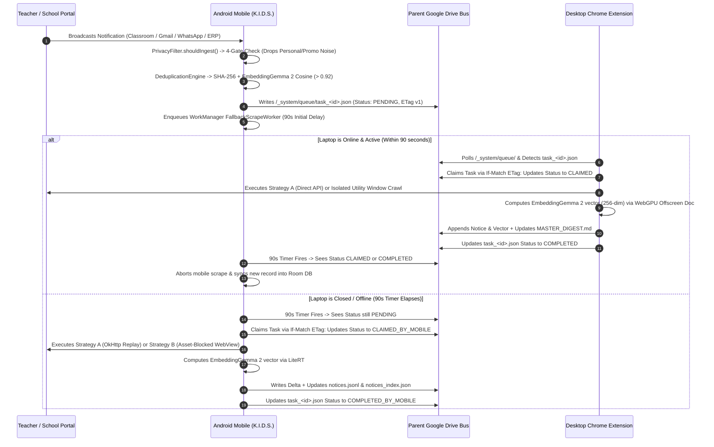
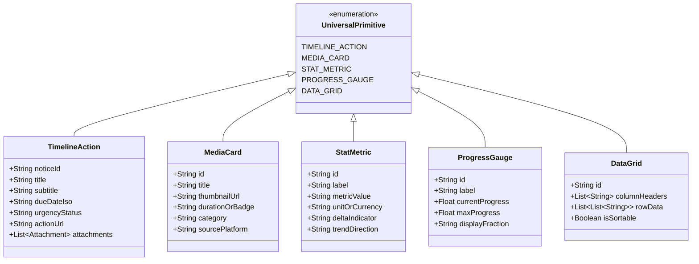
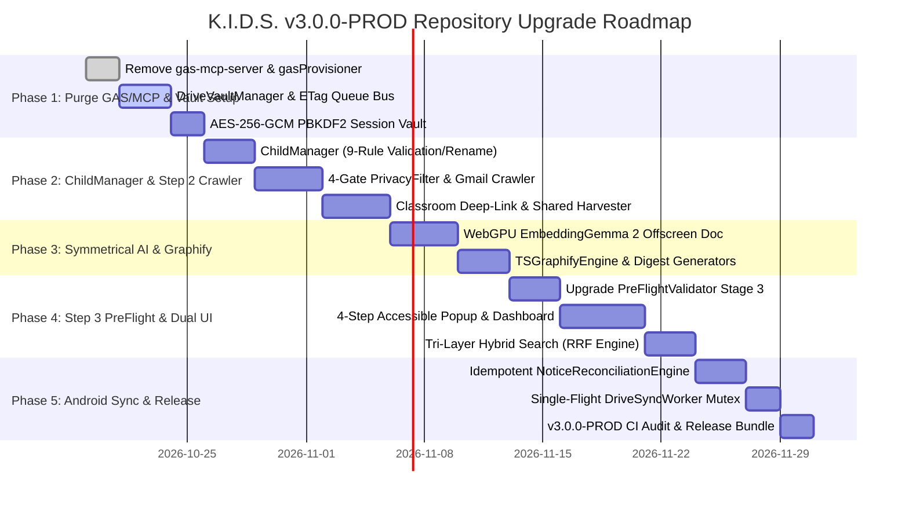

# Product Requirements Document (PRD) & Technical Specification
## Decentralized Cross-Device Scraping, Autonomous API Discovery & Adaptive UI Engine (K.I.D.S. Ecosystem)

**Document Version:** `3.0.0-PROD` (Complete Repository-Aligned Upgrade Specification — Zero-MCP & Zero-GAS Architecture)  
**Standard Compliance:** September 2026 Standard (Kotlin K2, Jetpack Compose Material 3, Chrome MV3, LiteRT, WebGPU / ONNX Runtime Web, Google Drive REST v3, Chrome Prompt API)  
**System Classification:** Ambient, Zero-Backend ($0 Cloud Infrastructure), Zero-MCP, Zero-Apps-Script, 100% On-Device Symmetrical AI  
**Authoritative Repositories:**
- **Mobile Collector Core:** [daarshnicsanjeev/K.I.D.S](https://www.google.com/search?q=https%3A%2F%2Fgithub.com%2Fdaarshnicsanjeev%2FK.I.D.S) (`c:/K.I.D.S` — Android Companion, Room SQLite FTS4, MLKitOcrParser, KotlinGraphifyEngine, KidsAccessibilityService, KidsNotificationListenerService, ShareTargetActivity, LiteRT EmbeddingGemma 2)
- **Desktop Extension & Portal Engine (Target Upgrade Repo):** [daarshnicsanjeev/school-mcp-sync-engine](https://www.google.com/search?q=https%3A%2F%2Fgithub.com%2Fdaarshnicsanjeev%2Fschool-mcp-sync-engine) (`C:/Users/daars/.gemini/antigravity/scratch/school-mcp-sync-engine` — Upgraded from v1.0 MCP/GAS Wizard to v3.0 Self-Contained Chrome MV3 Vault Engine, Main-World + CDP Interceptor, PreFlightValidator, SanitizerService, ErrorHasher, WebGPU EmbeddingGemma 2 Offscreen Document, Comprehensive Gmail & Classroom Stream Crawler, Dual-Surface Accessible UI)

## 1. Executive Summary & Product Vision

### 1.1 The Core Problem
Modern parents and digital guardians face an increasingly fragmented educational and developmental landscape. Critical notices, assignments, circulars, fee deadlines, shadow-teacher session logs, progress reports, and media activities are siloed across incompatible, walled-garden applications:
1. **Google Classroom & School Gmail:** Often locked behind strict Enterprise/Education domain security policies (e.g., `@myglobal.school`, `@wittykidsindia.com`, `@sjbhs.org`) where third-party OAuth apps encounter `access_not_configured` or require domain administrator whitelist approval. Parents receive a deluge of emails—some containing circulars with PDF attachments, some from shadow-support educators (e.g., Little Pods daily session logs), and others containing notification links to Classroom posts where the actual instructions, scoring rubrics, and worksheets are hosted.
2. **Proprietary School ERPs (Edusprint+, CampusCare, Toddle, Edunext, Veracross, Powerschool):** Session-authenticated Single Page Applications (SPAs) and legacy portals that do not expose public APIs, requiring daily manual parent logins across multiple sibling accounts.
3. **Informal Parent Communication Channels (WhatsApp, Telegram):** Hundreds of daily chat messages containing scattered circular photos, homework schedules, and PDF attachments buried beneath high-volume parent chatter (`"Thank you ma'am"`, `"👍"`, `"+1"`).
4. **Autonomous Digital Activities (YouTube Kids, Science Speedway, Duolingo, Roblox):** Separate activity logs, practice quiz reports, streak counters, and ledger metrics that are difficult to track cohesively alongside academic obligations.

Existing scraping and aggregation products—as well as v1.0 of `school-mcp-sync-engine`—relied on Google Apps Script (`script.google.com`) web app proxies or Model Context Protocol (MCP) servers. In production, those approaches introduce severe bottlenecks:
- **Google Apps Script Quotas & Timeouts:** Strict 6-minute execution ceilings, `UrlFetchApp` daily quota exhaustion, `PropertiesService` 9KB per-key storage limits, and complex multi-step OAuth / Clasp deployment friction (`access: "ANYONE"` security risks).
- **MCP Middleware Fragility:** Requiring external AI clients or JSON-RPC bridges to view daily homework creates unnecessary failure points when parents simply want a fast, accessible dashboard on their phone and laptop.
- **Third-Party Cloud Liabilities:** Hosted browser farms (Puppeteer/Playwright in AWS/GCP) and external vector databases cost $15–$50/user/month and expose minor students' PII and session cookies outside the family's private storage.

### 1.2 The K.I.D.S. v3.0 Solution (Zero-MCP, Zero-GAS, Unified Drive Vault)
The **Kids Intelligent Dashboard System (K.I.D.S.)** delivers an autonomous, zero-cost, serverless cross-device data harvesting and intelligence ecosystem.

**Core Architectural Shift in v3.0:**  
All **Model Context Protocol (MCP) servers** and **Google Apps Script (`gas-mcp-server`, `gas-error-webhook`, `gasProvisioner.ts`, `autoDeployScript.ts`)** components are **completely eliminated**. The entire system operates as a **Self-Contained Data Hub & Output Synthesis Engine**:
1. **Single Unified Google Drive Vault:** All educational data, circulars, direct email attachments, Classroom worksheets, Drive `"Shared with me"` resources, and portal metrics are scraped directly into **ONE central place in the parent's Google Drive** (`K.I.D.S. Data/`).
2. **Comprehensive Gmail Ingestion with Classroom Deep-Link Resolution:** Captures **ALL school and shadow-teacher emails** in the student/parent mailbox (circulars, fee reminders, principal bulletins, bus updates, shadow session notes) with direct attachment downloads, AND automatically follows deep links inside Classroom notification emails to scrape full post text, rubrics, and attached assignments directly from Classroom.
3. **Symmetrical Dual-Surface Consumption:** Both **Android Mobile (Jetpack Compose)** and **Desktop (Chrome Extension Popup + Full-Tab Dashboard)** consume this unified Google Drive Vault directly to render rich, interactive dashboards built around 5 Universal UI Primitives.
4. **Symmetrical Cross-Device Embedding Architecture (`EmbeddingGemma 2`):**
   - Both Desktop Chrome (via **WebGPU Offscreen Document**) and Android Mobile (via **LiteRT**) run the **exact same quantized `EmbeddingGemma 2` model** producing identical 256-dimensional Matryoshka Representation Learning (MRL) embeddings.
   - Desktop pre-computes vector embeddings during Phase 1 bulk crawls and persists them into `notices_index.json` on Google Drive, completely relieving the phone's battery of historical embedding generation overhead.
5. **Desktop Search Architecture Guardrail:** **Gemini Nano is strictly NOT used for searching files or records across Google Drive on Desktop.** Drive search on Desktop is powered by a high-speed, deterministic **Tri-Layer Hybrid Search Engine** (Google Drive REST API + Local IndexedDB BM25 FTS + `EmbeddingGemma 2` Vector Cosine Similarity fused via Reciprocal Rank Fusion). Gemini Nano on Desktop is reserved strictly for local selector synthesis, chat normalization, and grounded summarization of pre-retrieved results. On Android, search is powered by native **Room SQLite FTS4 (`notices_fts`) + LiteRT `EmbeddingGemma 2`**.

```
┌────────────────────────────────────────────────────────────────────────┐
│                        LAPTOP: CHROME EXTENSION (MV3)                  │
│                                                                        │
│  [Child & Portal Onboarding]       [On-Demand Portal Sniffer (Step 3)] │
│  (Desktop-First Profile Setup)     (Main-World Hook + CDP Interceptor) │
│              │                                     │                   │
│              ▼                                     ▼                   │
│  [Step 2: Comprehensive Gmail]     [PreFlightValidator & Sanitizer]    │
│  • Captures ALL school emails      (Stage 1 Session, Stage 2 Fetch,    │
│  • Downloads direct attachments     Stage 3 Schema & Drive Vault)      │
│  • Classroom emails -> clicks link                 │                   │
│    scrapes full post & assignments                 │                   │
│  • Scrapes Course Stream tab &                     │                   │
│    Drive "Shared with me" folder                   │                   │
│              │                                     │                   │
│              ▼                                     ▼                   │
│  [EmbeddingGemma 2 on WebGPU] ──► Pre-computes 256-dim MRL embeddings  │
│  (Runs via Chrome Offscreen Doc)   Saves vectors to Drive notices_index│
│              │                                     │                   │
│              └──────────────────┬──────────────────┘                   │
│                                 │                                      │
│                  Writes Recipes, Digests & Baseline History            │
└─────────────────────────────────┼──────────────────────────────────────┘
                                  │
                                  ▼
┌────────────────────────────────────────────────────────────────────────┐
│             SHARED DECENTRALIZED BUS: PARENT'S GOOGLE DRIVE            │
│                                                                        │
│  • K.I.D.S. Data/_system/config/profiles_registry.json                 │
│  • K.I.D.S. Data/_system/config/recipes/recipe_<id>.json               │
│  • K.I.D.S. Data/_system/config/auth/session_auth.json (AES-256-GCM)   │
│  • K.I.D.S. Data/_system/queue/task_<timestamp>_<uuid>.json            │
│  • K.I.D.S. Data/_system/data/baseline/history_<id>.json               │
│  • K.I.D.S. Data/_system/data/updates/delta_<timestamp>_<device>.json  │
│  • K.I.D.S. Data/ui/layout_manifest.json                               │
│  • K.I.D.S. Data/{AcademicYear}/FAMILY_DIGEST.md                       │
│  • K.I.D.S. Data/{AcademicYear}/{ChildName}/ (Master Child Vault)      │
│      ├── notices.jsonl, notices_index.json & MASTER_DIGEST.md          │
│      ├── graph.html (Offline Interactive D3 Force-Directed Graph)      │
│      ├── Google Classroom/ (notices.jsonl, CLASSROOM_DIGEST.md, files) │
│      ├── _system/ (knowledge_graph.json, SYSTEM_STATUS.md, logs/,      │
│      │             diagnostics/kids_vault.db, database_dump.json)      │
│      └── attachments/ (OCR-indexed circulars & homework PDFs)          │
└─────────────────────────────────▲──────────────────────────────────────┘
                                  │
                                  │ Reads Queues / Writes Deltas / Syncs
                                  │
┌─────────────────────────────────┴──────────────────────────────────────┐
│                    MOBILE: ANDROID APPLICATION (K.I.D.S.)              │
│                                                                        │
│  [One-Click Google Auto-Pair]  ──► Auto-discovers Profiles & Portals   │
│                │                   Reuses pre-computed vectors (0 OOM) │
│                ▼                                                       │
│  [Step 0 Mandatory Gate]       ──► Restricted Settings + Accessibility │
│                │                                                       │
│                ▼                                                       │
│  [NotificationListenerService] ──► Real-time push + ShareTargetActivity│
│                │                                                       │
│                ▼                                                       │
│  [Opportunistic Fallback]      ──► Strategy A (OkHttp API Replay)      │
│                                    Strategy B (Asset-Blocked WebView)  │
│                │                                                       │
│                ▼                                                       │
│  [MLKitOcrParser + Room FTS4]  ──► KotlinGraphifyEngine & Compose UI   │
└────────────────────────────────────────────────────────────────────────┘
```

## 2. Strategic Invariants & Safety Guardrails

All code and architecture implementations across `K.I.D.S` and `school-mcp-sync-engine` must strictly adhere to six non-negotiable architectural invariants:

### 2.1 Zero-Backend, Zero-MCP & Zero-Apps-Script Invariant ($0 Cloud Cost)
1. **No External Cloud Servers:** Student data, homework, circulars, session tokens, and analytics MUST NEVER be routed through external cloud servers, proxy relays, or hosted databases.
2. **No Google Apps Script (`script.google.com`):** All `gas-mcp-server`, `gas-error-webhook`, `GasProvisionerService`, and `autoDeployScript.ts` code paths are permanently retired. No script projects or Web App URLs (`https://script.google.com/macros/s/.../exec`) are created or called.
3. **No MCP Server Middleware:** Data is persisted directly into the structured Google Drive Vault (`K.I.D.S. Data/`) via the Google Drive REST v3 API (`https://www.googleapis.com/drive/v3` and `https://www.googleapis.com/upload/drive/v3`) and consumed natively by the Chrome Extension UI and Android Jetpack Compose UI.

### 2.2 Restricted Privacy Scope (`drive.file` & `spreadsheets` Only)
In `school-mcp-sync-engine` v1.0, `manifest.json` requested broad restricted scopes (`gmail.readonly`, `drive.readonly`, `script.projects`, `script.deployments`, `classroom.courses.readonly`, `calendar.events.readonly`). In v3.0, all broad scopes are stripped. The OAuth 2.0 scopes requested by both Android and Desktop MUST strictly be:
- `https://www.googleapis.com/auth/drive.file` (Grants access strictly to files and folders created or opened by K.I.D.S.).
- `https://www.googleapis.com/auth/spreadsheets` (Used exclusively for appending rows to the *K.I.D.S. School Sync* master spreadsheet).
- `https://www.googleapis.com/auth/userinfo.email` and `openid` (Used for parent identity verification and deterministic key derivation).

All Gmail and Google Classroom harvesting on Desktop operates directly through the authenticated browser session (`credentials: "include"` / isolated utility window DOM & internal XHR), completely bypassing domain administrator OAuth blocks (`access_not_configured`).

### 2.3 Symmetrical On-Device AI & Search Engine Guardrails
- **Symmetrical Vector Model (`EmbeddingGemma 2`):**
  - **Desktop Chrome:** Runs quantized `EmbeddingGemma 2` (ONNX INT8/INT4, $\sim 148\text{ MB}$ cached in OPFS/IndexedDB) inside a dedicated Chrome **Offscreen Document** (`offscreen.html`) accelerated by **WebGPU** (with WASM SIMD128 fallback). Produces 256-dimensional L2-normalized MRL embeddings in $< 15\text{ms}$.
  - **Android Mobile:** Runs the identical `EmbeddingGemma 2` model via **Google LiteRT** (RAM $< 200\text{ MB}$).
  - **Cross-Runtime Vector Parity:** Cosine similarity between Desktop WebGPU and Android LiteRT vectors for identical text must satisfy $\cos(\mathbf{v}_{\text{desktop}}, \mathbf{v}_{\text{mobile}}) \ge 0.998$.
- **Desktop Search Architecture Guardrail:**
  - **Gemini Nano is strictly NOT used for searching files or records in Google Drive.** Google Drive searches are executed via a **Tri-Layer Hybrid Search Engine** combining:
    1. Google Drive REST API query engine (`files.list` with `q=...`).
    2. Local client-side IndexedDB Full-Text Search (BM25 inverted index).
    3. In-memory cosine similarity over local 256-dim `EmbeddingGemma 2` vectors.
  - **Gemini Nano Role:** Chrome Built-in AI (`window.ai.languageModel` / Prompt API) is reserved strictly for: (1) Synthesizing dynamic CSS/ARIA selectors during Step 3 inspection, (2) Normalizing raw chat turn strings into structured JSON, and (3) Generating 2-sentence grounded summaries over the top $k=3$ pre-retrieved hybrid search results.
- **Android Search Engine:** **Room SQLite FTS4 (`notices_fts`)** + **LiteRT `EmbeddingGemma 2`**.

### 2.4 Strict Memory-Boundary Privacy Filtering & Personal-Account Noise Isolation
> **Production Lesson Learned (From Live `database_dump.json` Audit):** When a parent's device has both personal email accounts (`daarshnicsanjeev@gmail.com`, `daarshnicsanjeev@hotmail.com`) and student accounts (`atharva.chaodhari@myglobal.school`, `anvesharprasad@sjbhs.org`) logged into Gmail, unguarded ingestion captures promotional spam (`Eureka Forbes`, `Tapi Carpets`, `Facebook Friend Suggestions`, `Kuvera`, `ChatGPT`) and parent professional courses (`Skill Arbitrage`, `Naukri MINIs`) into the child's school digest.

To eliminate this permanently, `PrivacyFilter.kt` (Android) and `GmailClassroomCrawler.ts` (Desktop) enforce a mandatory **4-Gate Memory-Boundary Filter** BEFORE any Room DB insertion or Drive upload:
1. **Gate 1 — Package Allowlist:** On Android, only notifications from `com.google.android.apps.classroom`, `com.google.android.gm`, `com.google.android.apps.docs`, `com.whatsapp`, `com.whatsapp.w4b`, and onboarded ERP packages (e.g., `com.entab.campuscare`, `in.edusprint.wittykids`) are inspected.
2. **Gate 2 — OTP, Banking & Promotional Regex Blocklist:** Immediately drops any payload matching OTP/financial/promotional signatures:
   - OTP/Banking: `/\b(?:OTP|one[- ]time password|verification code|cvv|aadhaar|debited|credited|upi|netbanking)\b/i`
   - Promotional/Social Noise: `/\b(?:unsubscribe|view in browser|festive sale|% off|friend suggestion|birthday card|linkedin|naukri|job opening|gratuity|mutual fund|gold etf|copilot experience)\b/i`
   - Non-Child Adult Course & Marketing Senders: Explicitly blocks adult professional/commercial senders (`skillarbitra`, `lawsikho`, `growthschool`, `be10x`, `finright`, `eurekaforbes`, `tapi`, `kuvera`, `facebookmail`, `redditmail`, `freelists.org`).
3. **Gate 3 — Strict Recipient & Student-Account Binding:**
   - If an email/notification arrives on a **bound student account** (e.g., `atharva.chaodhari@myglobal.school`, `atharva.cwig680@wittykidsindia.com`, or `anvesharprasad@sjbhs.org`), it passes to classification.
   - If an email arrives on the **parent's personal email account** (`daarshnicsanjeev@gmail.com` or `daarshnicsanjeev@hotmail.com`), it is **REJECTED BY DEFAULT** unless the sender or body explicitly matches:
     - A whitelisted school domain (`@myglobal.school`, `@wittykidsindia.com`, `@globalschoolsfoundation.org`, `@sjbhs.org`), OR
     - A whitelisted shadow-support/special-educator handle (`@littlepods.in`, `Prarthana Sawant`, `Shadow Session`), OR
     - The child's full name (`Atharva`, `Anvesha`) paired with an academic keyword (`Grade 3`, `STD- VIII`, `homework`, `circular`, `school`, `fee`, `exam`).
4. **Gate 4 — PII Sanitization (`SanitizerService`):** All diagnostic logs and recipe specs pass through `SanitizerService.sanitizeString()`, `sanitizeCookies()`, `sanitizeHeaders()`, and `sanitizeErrorPayload()` (`[REDACTED_EMAIL]`, `[REDACTED_PHONE]`, `[REDACTED_TOKEN]`, `[REDACTED_COOKIE]`).

### 2.5 Universal Design, Screen-Reader First Accessibility (JAWS / NVDA / TalkBack) & WCAG 2.1 AA/AAA
Because the platform is designed and used by power users relying on assistive technology (**JAWS**, **NVDA** on Windows Chrome, and **TalkBack** on Android):
- **100% Keyboard & Screen-Reader Operability:** Every control in `popup/index.html`, `dashboard.html`, and Android Compose must be reachable via `Tab` / `Shift+Tab` / Arrow keys with explicit focus rings (`outline: 2px solid #ED8936`), proper ARIA landmarks (`role="main"`, `role="navigation"`, `role="region"`), live status announcements (`aria-live="polite"` for sync progress, `role="alert"` for validation errors), and semantic headings (`<h1>`–`<h3>`).
- **No Mouse-Only Visual Pickers:** Step 3 portal tracking MUST provide a keyboard-navigable **Accessible Semantic Region List** (dropdown/listbox of detected tables, `<article>` feeds, and `[role="tabpanel"]` regions) so a JAWS/NVDA user never has to hover a mouse over visual DOM boxes.
- **Touch Targets & Contrast:** Minimum bounding box of **$48\text{dp} \times 48\text{dp}$** ($48\text{px} \times 48\text{px}$); contrast ratios $\ge 4.5:1$ for body text and $\ge 7:1$ for headings.
- **Brand Typography & Palette:** **Kanit** (`600 SemiBold` / `700 Bold`) for Headings/KPIs, **Poppins** (`400 Regular` / `500 Medium` / `600 SemiBold`) for Body/Controls, **JetBrains Mono** for logs/selectors; Deep Navy (`#1A365D`), Amber Orange (`#ED8936`), Urgent Crimson (`#9B2C2C`), Emerald (`#2F855A`), Light Slate (`#E2E8F0`), Off-White (`#F7FAFC`), Surface White (`#FFFFFF`).

### 2.6 Zero-Hardcoding Quality Gate
Static pixel coordinates, hardcoded academic years (`"2026-2027"`), hardcoded class labels (`"3B"`, `"8B"`), arbitrary loop counts (`MAX_PAGES = 60`), and developer handles are strictly banned. All builds must pass `python scripts/verify_zero_hardcode.py` (with documented protocol exemptions tracked in `.hardcode-exemptions.json`).

## 3. Repository Upgrade Architecture: `school-mcp-sync-engine` (v1.0 $\rightarrow$ v3.0)

To upgrade `daarshnicsanjeev/school-mcp-sync-engine` without losing any existing capabilities from either repository, the following file-by-file transformation specification governs the codebase upgrade:

### 3.1 File-by-File Migration, Retention & Deprecation Matrix

| Existing Path in `school-mcp-sync-engine` | Action in v3.0 | Replacement / Upgrade Specification |
| :--- | :--- | :--- |
| `gas-mcp-server/*` (`Code.gs`, `PortalApiFetcher.gs`, `WorkspaceFetcher.gs`, `StorageRepository.gs`, `GasTests.gs`) | **DELETE DIRECTORY** | Google Apps Script & MCP Server completely removed. Logic ported natively into Chrome Extension TypeScript services below. |
| `gas-error-webhook/*` | **DELETE DIRECTORY** | Replaced by `DriveDeepLogger.ts` writing sanitized error fingerprints directly to `K.I.D.S. Data/_system/logs/`. |
| `extension/src/services/gasProvisioner.ts` | **DELETE FILE** | Replaced by `DriveVaultManager.ts` (provisions `K.I.D.S. Data/` folder hierarchy directly via Google Drive REST API v3). |
| `extension/src/content/autoDeployScript.ts` | **DELETE FILE** | No longer needed since `script.google.com` automated clicking/deployment is eliminated. |
| `extension/src/content/mainWorldInterceptor.ts` | **KEEP & UPGRADE** | Retain IIFE main-world `window.fetch` and `XMLHttpRequest` hooks (`window.__school_mcp_interceptor_injected`); add response JSON body capture for Strategy A API heuristic scoring. |
| `extension/src/content/interceptor.ts` | **KEEP & UPGRADE** | Retain `SCHOOL_MCP_INTERCEPTED_REQUEST` window listener & `RECORD_INTERCEPTED_SPEC` bridge; add Accessible Semantic Container discovery for Step 3 Strategy B. |
| `extension/src/services/sanitizer.ts` & `tests/sanitizer.test.ts` | **KEEP & EXPAND** | Retain `SanitizerService` (`EMAIL_REGEX`, `PHONE_REGEX`, `AUTH_TOKEN_REGEX`, `sanitizeString`, `sanitizeCookies`, `sanitizeHeaders`, `sanitizeErrorPayload`). |
| `extension/src/services/errorHasher.ts` & `tests/errorHasher.test.ts` | **KEEP 100%** | Retain `ErrorHasher.generateFingerprint(domain, component, stackTrace)` (12-char SHA-256 hex) and `cleanStackTrace()` for error deduplication and recipe staleness tracking. |
| `extension/src/services/preflight.ts` | **KEEP & UPGRADE** | Retain `PreFlightValidator` Stage 1 (`stage1LocalSessionProbe`) and Stage 2 (`stage2ExtensionFetchVerification`). Replace Stage 3 (`stage3GasProxyVerification`) with `stage3DriveVaultAndSchemaVerification`. |
| `extension/src/popup/index.html` & `wizard.ts` | **UPGRADE TO 4-STEP** | Replace GAS/MCP setup inputs (`gasUrlInput`, `btnCreateMcpServer`) with the 4-Step K.I.D.S. Onboarding Wizard + Context-Aware Quick Home Screen (Section 10.2). |
| `extension/src/background/serviceWorker.ts` | **UPGRADE** | Replace GAS provisioning handlers with Drive Vault sync, Step 2 Gmail/Classroom crawler orchestration, `/_system/queue/` lock bus polling, and Offscreen WebGPU coordinator. |
| *(New)* `extension/src/services/childManager.ts` | **ADD MODULE** | Implements 9-rule `validateFirstName`, sibling collision check, Title-Casing, locked/in-place edit state machine, atomic Drive folder rename, and soft-unlink. |
| *(New)* `extension/src/services/gmailClassroomCrawler.ts` | **ADD MODULE** | Ports `WorkspaceFetcher.gs` + `K.I.D.S` `harvest_classroom_stream.py` into native TS: full Gmail crawler, dynamic $G_{\text{current}}-1$ boundary, Classroom deep-link follower, Stream backfill, and `cleanAttachmentTitle`. |
| *(New)* `extension/src/services/driveSharedHarvester.ts` | **ADD MODULE** | Ports `GoogleDriveSharedHarvester.kt` / `harvest_drive_shared.py`: scans Drive `"Shared with me"` educational folders and archives files into the child's vault. |
| *(New)* `extension/src/services/whatsappExportParser.ts` | **ADD MODULE** | Ports `WhatsAppChatExportParser.kt`: parses `.txt` and `.zip` WhatsApp exports, links media attachments, and runs the 3-stage parent chatter filter. |
| *(New)* `extension/src/offscreen/offscreen.ts` | **ADD MODULE** | Hosts quantized `EmbeddingGemma 2` (WebGPU / WASM SIMD128) for $<15\text{ms}$ 256-dim MRL vector generation and PDF/image canvas OCR. |
| *(New)* `extension/src/services/graphifyEngine.ts` | **ADD MODULE** | Ports `KotlinGraphifyEngine.kt` to TS: compiles `knowledge_graph.json`, zero-CDN `graph.html`, `MASTER_DIGEST.md`, `CLASSROOM_DIGEST.md`, and `FAMILY_DIGEST.md`. |
| *(New)* `extension/src/dashboard/dashboard.html` & `dashboard.ts` | **ADD SURFACE 2** | Full-tab command center rendering the 5 Universal UI Primitives (`layout_manifest.json`), Tri-Layer Hybrid Search (RRF), Child/Portal manager, and Android Auto-Pairing status. |

## 4. User Personas, Multi-Child Routing & Target Platforms

### 4.1 Primary Personas & Real Household Context
- **The Multi-Kid Working Parent (e.g., Sanjeev managing Atharva & Anvesha):**
  - **Atharva:** Attends Witty International School / MyGlobal School (`Grade 3B CAIE / IG`, student emails `atharva.chaodhari@myglobal.school` and `atharva.cwig680@wittykidsindia.com`, portal `wittykids.edusprint.in`, shadow support educator **Prarthana Sawant** from **Little Pods** sending daily session notes).
  - **Anvesha:** Attends St. Joseph's Boys' High School (`SJBHS`, `STD- VIII (B) SECONDARY`, student email `anvesharprasad@sjbhs.org`, Principal Rev. Fr. Dr. T. and teacher Fiona Mendonza circulars).
- **The Assistive-Tech Power Parent:** Navigates Windows Chrome via **JAWS** or **NVDA** and Android via **TalkBack**, requiring deterministic keyboard shortcuts, zero visual-only mouse pickers, clean Markdown digests (`MASTER_DIGEST.md`), and structured spreadsheet ledgers.

### 4.2 Deterministic Multi-Child Attribution Engine (`MultiChildRouter`)
Every ingested email, Classroom post, ERP card, Drive shared file, and WhatsApp message is routed to the correct child profile(s) via a deterministic **5-Tier Attribution Cascade**:

| Priority Tier | Attribution Signal | Match Logic | Multi-Child Broadcast Behavior |
| :--- | :--- | :--- | :--- |
| **Tier 1: Explicit Account / Portal Binding** | Authenticated Gmail `/u/{n}/` prefix, `studentAccountEmail`, or ERP `recipe.childId` | Exact match against `childProfile.accountEmail` (e.g., `atharva.chaodhari@myglobal.school` $\rightarrow$ Atharva; `anvesharprasad@sjbhs.org` $\rightarrow$ Anvesha). | Assigned exclusively to the bound child. |
| **Tier 2: Whitelisted Educator / Group / Course** | Shadow teacher email/name (`prarthanasawant@littlepods.in`), WhatsApp `conversationTitle`, or Classroom `courseId` | Match against `childProfile.channels[]` or `whitelistedSenders[]`. | Assigned to all children mapped to that educator/group/course. |
| **Tier 3: Explicit Name, Grade & Roll Mention** | Notice subject, body text, or OCR attachment text | Regex boundary match for `firstName` (`Atharva`, `Anvesha`), `disambiguationTag`, or `grade` (`Grade 3B`, `STD- VIII (B)`). | Assigned to each matched child profile. |
| **Tier 4: School Domain / Institution Match** | Sender email domain or school header in PDF circular (`Witty International School`, `SJBHS`) | Matches `childProfile.schoolName` or domain when siblings attend the same school and no specific grade is restricted. | Broadcasts to all sibling profiles at that school (`sharedNotice = true`, binary attachment uploaded once). |
| **Tier 5: Unassigned Quarantine / Drop** | Personal parent email (`daarshnicsanjeev@gmail.com` / `@hotmail.com`) with zero matches across Tiers 1–4 | Dropped by `PrivacyFilter` if commercial/adult; held in Unassigned Review queue if educational keywords are present. | Never pollutes a child's `MASTER_DIGEST.md` unverified. |

### 4.3 Supported Data Domains & Target Platforms

| Platform Domain | Target Entities Extracted | Ingestion Mechanism |
| :--- | :--- | :--- |
| **School Gmail & Shadow Educator Logs** | **ALL school emails:** official circulars, fee reminders, transport alerts, principal letters, and **Shadow Teacher daily session notes** (e.g., Little Pods). Direct attachments downloaded to Drive & OCR-indexed. | Desktop Chrome Extension Gmail Crawler + Android `KidsNotificationListenerService`. |
| **Google Classroom** | Coursework, materials, assignments, due dates, point rubrics, attached PDFs/PPTXs/worksheets, audio files, teacher stream posts. | **Phase 1 (Desktop):** Follows deep links inside Classroom notification emails -> scrapes full post and downloads attachments. Then crawls Course Stream tab & Classwork tab (skipping files already downloaded via Gmail).<br>**Phase 2 (Mobile):** Push notification listener + scoped delta capture. |
| **Google Drive `"Shared with me"` (`GoogleDriveSharedHarvester`)** | Curriculum folders, syllabus PDFs, model papers, and audio worksheets shared directly by teachers via Google Drive links without Classroom posts. | Automated harvester scanning `"Shared with me"` items authored by school domains or linked in circulars, copying files into `K.I.D.S. Data/{Year}/{Child}/attachments/`. |
| **School ERPs (Edusprint+, CampusCare, Toddle, Edunext)** | Homework cards, official circulars, exam schedules, fee receipts, attendance %. | **Step 3 On-Demand Capture:** Dual-World Interceptor (`mainWorldInterceptor.ts` + CDP) + `PreFlightValidator`. **Phase 2:** Android 90s fallback via OkHttp or Asset-Blocked WebView. |
| **WhatsApp School Groups & Android Share Sheet** | Teacher notices, timetable images, circular PDFs, holiday announcements (parent chatter stripped). | **Phase 1:** `.txt`/`.zip` export parser (`WhatsAppChatExportParser`).<br>**Phase 2:** Ambient `KidsNotificationListenerService` + `DownloadFolderObserver` + **`ShareTargetActivity`** (1-tap "Share to K.I.D.S." from any app). |
| **Educational Media & Micro-Games (YouTube Kids, Science Speedway, Duolingo, Roblox)** | Watch history, practice quiz accuracy/mastery stats (e.g., `Science Speedway` unique practiced, 1st-attempt mastered, repeated mistakes), streaks, XP. | Desktop extension passive tab/localStorage extraction mapped to `MEDIA_CARD`, `STAT_METRIC`, and `PROGRESS_GAUGE`. |

## 5. Dual-Phase Ingestion, Transactional Lock Bus & Attachment Reconciliation



### 5.1 Phase 1: Bulk Baseline Capture (Desktop-Bound)
- **Execution Scope:** Restricted strictly to the Chrome Extension on desktop.
- **Traversal & Pre-Computation:**
  - Crawls historical School Gmail threads, Google Classroom courses (Stream + Classwork tabs), and Google Drive `"Shared with me"` school folders back to the dynamically discovered start of the current academic grade.
  - Downloads binary worksheets/circulars into `K.I.D.S. Data/{AcademicYear}/{ChildName}/attachments/` (and `Google Classroom/attachments/`), extracting multi-page text via streaming OCR formatted with `[--- Page X of Y ---]` headers.
  - Pre-computes 256-dimensional L2-normalized MRL embeddings via `EmbeddingGemma 2` on WebGPU and writes them to `notices_index.json` on Drive.
- **Cryptographic Sync Watermark:**
  - Emits `/_system/data/baseline/history_<sourceId>.json` containing `lastSyncedTimestampIso`, `highestNumericalId`, `discoveredCurrentGrade`, and a SHA-256 Bloom filter (`falsePositiveRate = 0.001`, `capacity = 10000`) plus an exact rolling ring buffer of the latest 2,000 `seenEntityHashes`.

### 5.2 Phase 2: Incremental Delta Capture & Single-Flight Sync Mutex
- **Event Trigger:** Incoming notification intercepted by `KidsNotificationListenerService`, file shared via `ShareTargetActivity`, or file detected by `DownloadFolderObserver`.
- **Two-Stage Deduplication (`DeduplicationEngine.kt` & `deduplicator.ts`):**
  1. **Cross-Source Title & Canonical ID Consolidation (`consolidateDuplicateNoticesAndStaleStubs`):**
     - When a teacher posts to Google Classroom, the parent often receives *both* a Classroom app notification (`sourceApp = "com.google.android.apps.classroom"`, e.g., `"New material from Alyssa Chiramel: Kinds of Sentence Worksheet • See details"`) AND a Gmail notification email (`sourceApp = "com.google.android.gm"`, e.g., `"New material: \"Kinds of Sentence Worksheet\""`) within seconds of each other.
     - `DeduplicationEngine` normalizes Classroom titles by stripping prefixes (`/^New (?:material|assignment|announcement|question)(?: from [^:]+)?:\s*"?([^"\n•]+)"?.*$/i` $\rightarrow$ `"Kinds of Sentence Worksheet"`).
     - If a stub notification from the Classroom app and a rich notification/deep-link from Gmail share the same normalized title or `classroomPostId` within a 24-hour window, they are **consolidated into a single rich notice record** rather than creating duplicate rows in `notices.jsonl` and `MASTER_DIGEST.md`.
  2. **Semantic Vector Deduplication:** Computes 256-dim `EmbeddingGemma 2` embedding; if cosine similarity with any notice ingested in the last 6 hours exceeds `0.92`, merges metadata into the existing notice.
- **Single-Flight WorkManager Mutex (Preventing `JobCancellationException`):**
  - *Production Fix (From `app_logcat.log` Audit):* Previously, rapid incoming notifications or crawler state changes enqueued overlapping `DriveSyncWorker` runs with `ExistingWorkPolicy.REPLACE`, causing active sync coroutines to fail mid-upload with `kotlinx.coroutines.JobCancellationException` during Graphify digest generation and SQLite WAL checkpointing.
  - **Mandatory v3.0 Rule:** `DriveSyncWorker` MUST be enqueued using `ExistingWorkPolicy.KEEP` (or `APPEND_OR_REPLACE` on a serial work chain) backed by a process-wide `Mutex` (`SyncExecutionMutex`), and `DiagnosticsMirror` + `KotlinGraphifyEngine` must run inside `withContext(NonCancellable)` once file upload begins so database snapshots and digests never abort half-written.

### 5.3 Deterministic Attachment Reconciliation (`NoticeReconciliationEngine`)
- **Problem Addressed (From `crawler_trace.log` Audit):** In `crawler_trace.log`, attachments like `"Subtraction Level 2.pdf"` oscillated back and forth on every sync cycle between two similarly named notices (`"New material: Addition & Subtr..."` $\leftrightarrow$ `"New material: Addition and Sub..."`).
- **Idempotent Reconciliation Invariant:**
  1. Every attachment stores an immutable `parentClassroomPostId` or `parentGmailMessageId` when harvested from a specific post/email.
  2. `NoticeReconciliationEngine` only runs heuristic title/timestamp matching for **orphan attachments** (`noticeId == "UNASSIGNED"` or stub notice).
  3. Once an attachment is linked to a verified notice and `isReconciledLocked = true` is set in the `attachments` table, `NoticeReconciliationEngine` MUST NEVER rebalance or move it to another notice on subsequent sync cycles.

### 5.4 Cross-Device Transactional Lock Bus Protocol & Concurrency Control
Google Drive coordinates cross-device tasks via transactional JSON files in `/_system/queue/task_<timestamp>_<uuid>.json`:

```json
{
  "schemaVersion": "3.0.0",
  "taskId": "task_20261018_083201_492a8f",
  "childName": "Atharva",
  "academicYear": "2026-2027",
  "packageName": "com.google.android.apps.classroom",
  "sourceType": "CLASSROOM_PUSH",
  "notificationTitle": "New Assignment: Mathematics Chapter 8",
  "notificationText": "Due Tomorrow at 5:00 PM. Complete exercises 1-10.",
  "targetUrl": "https://classroom.google.com/c/ODU1NzM5/a/NTg2MTky/details",
  "recipeId": "recipe_classroom_default",
  "contentSha256": "e3b0c44298fc1c149afbf4c8996fb92427ae41e4649b934ca495991b7852b855",
  "status": "PENDING",
  "retryCount": 0,
  "maxRetries": 3,
  "createdAt": "2026-10-18T08:32:01.492Z",
  "claimedBy": null,
  "claimedAt": null,
  "completedAt": null,
  "errorDetails": null
}
```

**Optimistic Concurrency & State Machine Rules:**
1. **`PENDING`:** Created by Android `KidsNotificationListenerService`. Drive returns an HTTP `ETag` for the newly created file.
2. **`CLAIMED` (Desktop Priority Window: 0–90s):** Desktop Chrome Extension polls `/_system/queue/` every 30 seconds via `chrome.alarms` (or immediately on browser focus). To claim a task, Desktop sends `PATCH https://www.googleapis.com/upload/drive/v3/files/{fileId}` with header `If-Match: "{etag}"` setting `status: "CLAIMED"` and `claimedBy: "desktop_<instanceId>"`.
3. **Race Condition Resolution:** If Android's 90-second timer fires at the exact millisecond Desktop claims the task, one device's `PATCH` request will fail with `HTTP 412 Precondition Failed` (ETag mismatch). The device receiving `412` immediately reads the updated file; if `claimedBy` belongs to Desktop, Android yields and exits cleanly.
4. **Lease Expiration & Zombie Recovery:** If a task remains in `CLAIMED` or `CLAIMED_BY_MOBILE` for $> 5\text{ minutes}$ without transitioning to `COMPLETED`, the lease is considered expired and either device may steal the lock by incrementing `retryCount` up to `maxRetries: 3`.
5. **`COMPLETED` / `COMPLETED_BY_MOBILE`:** Target content, attachments, and 256-dim vector have been persisted to Drive. Task file is garbage-collected after 24 hours.
6. **`AUTH_EXPIRED` / `RECIPE_STALE`:** Terminal error states that surface an actionable banner on both the Android and Chrome dashboards.

## 6. Autonomous "API-First" Discovery, Pre-Flight Validation & Dual-Strategy Extraction

### 6.1 Dual-World Network Interceptor (`mainWorldInterceptor.ts` + CDP)
Step 3 ("School Portals & Universal Site Tracking") combines two complementary interception mechanisms from `school-mcp-sync-engine`:
1. **Layer 1 — Main-World XHR/Fetch Hook (`mainWorldInterceptor.ts` & `interceptor.ts`):**
   - Injected into the page's `MAIN` execution world (`window.__school_mcp_interceptor_injected = true`).
   - Wraps `window.fetch` and `XMLHttpRequest.prototype.open` / `setRequestHeader` / `send`.
   - Captures `{ url, method, requestHeaders, requestBody, responseStatus, responseMimeType, responseJsonPreview, documentCookies }` in real time and posts `SCHOOL_MCP_INTERCEPTED_REQUEST` to `interceptor.ts`, which relays `RECORD_INTERCEPTED_SPEC` to `serviceWorker.ts`.
   - Operates silently without triggering Chrome's debugging banner.
2. **Layer 2 — On-Demand Chrome DevTools Protocol (`chrome.debugger` CDP):**
   - When a portal uses `HttpOnly` session cookies (such as `ASP.NET_SessionId` on Edusprint+ / CampusCare) that `document.cookie` cannot read, `serviceWorker.ts` reads them via `chrome.cookies.getAll({ domain })` and optionally attaches `chrome.debugger` (`Network.enable`) during Step 3 capture.
3. **Payload Heuristic Scoring ($S_{\text{api}} \in [0, 1]$):**
   - $+0.35$: Contains an array of homogeneous objects with length $\ge 2$.
   - $+0.30$: Objects contain identifier and title keys (`id`, `noticeId`, `assignmentId`, `title`, `subject`, `heading`, `topic`).
   - $+0.20$: Objects contain temporal or academic keys (`due_date`, `submissionDate`, `circularDate`, `createdAt`, `marks`, `grade`, `attendance`, `feeAmount`).
   - $+0.15$: Objects contain attachment or body keys (`description`, `body`, `content`, `attachmentUrl`, `pdfLink`, `files`).
   - Any endpoint scoring $S_{\text{api}} \ge 0.65$ is selected as Strategy A.

### 6.2 3-Stage Pre-Flight Validation Pipeline (`PreFlightValidator` in `preflight.ts`)
Before any captured portal functionality is saved as an active recipe in Google Drive, `PreFlightValidator.validate(domain, spec, cookies)` executes a mandatory **3-Stage Verification Pipeline**:
- **Stage 1 (`stage1LocalSessionProbe`):** Verifies that non-empty authentication cookies (`chrome.cookies.getAll`) or `Authorization` / `X-CSRF-Token` headers exist for the target portal domain.
- **Stage 2 (`stage2ExtensionFetchVerification`):** Replays the captured `EndpointSpec` (`{ url, method, headers, body }`) directly from the background service worker, verifying an HTTP `200 OK` response and confirming that the returned JSON/HTML payload contains $\ge 1$ valid domain entity.
- **Stage 3 (`stage3DriveVaultAndSchemaVerification` — Upgraded from v1.0 `stage3GasProxyVerification`):**
  - Evaluates the response against the 5 Universal UI Primitives (`TIMELINE_ACTION`, `STAT_METRIC`, `PROGRESS_GAUGE`, `MEDIA_CARD`, `DATA_GRID`).
  - Runs `SanitizerService` to strip raw credentials from the recipe template.
  - Encrypts the live session cookies/tokens into `/_system/config/auth/session_auth.json` (AES-256-GCM) and writes the declarative recipe to `/_system/config/recipes/recipe_<id>.json` in Google Drive.

### 6.3 Strategy B: Accessible Semantic Snapshot & Selector Hierarchy Ladder
When a school portal is Server-Side Rendered (SSR) HTML or an SPA without clean JSON APIs:
1. **Screen-Reader Friendly Semantic Region Discovery:**
   - `interceptor.ts` scans the live DOM for semantic landmarks (`main`, `article`, `section[aria-label]`, `[role="tabpanel"]`, `table`) and populates an accessible `<select id="selStep3SemanticRegion">` in the popup.
   - The parent selects the region (e.g., `"Homework Table (12 rows)"` or `"Circulars Feed (8 items)"`) using standard keyboard navigation.
2. **Attribute Hierarchy Ladder:**
   - Generates a resilient 4-tier selector ladder:
     1. `[data-testid]`, `[data-id]`
     2. ARIA roles/labels (`[role="row"]`, `[aria-label]`)
     3. Semantic HTML5 structure (`table > tbody > tr`, `article > h3`)
     4. Sanitized class names (dynamic CSS-in-JS hashes stripped).
3. **Android Headless WebView Sandbox:**
   - Evaluated on Android inside an off-screen `WebView` with `shouldInterceptRequest` blocking images, fonts, CSS, media, and analytics trackers:
     ```kotlin
     override fun shouldInterceptRequest(view: WebView, request: WebResourceRequest): WebResourceResponse? {
         val url = request.url.toString().lowercase()
         val blockedExtensions = listOf(".png", ".jpg", ".jpeg", ".gif", ".webp", ".svg", ".woff", ".woff2", ".ttf", ".otf", ".mp4", ".mp3", ".css")
         val blockedHosts = listOf("google-analytics.com", "googletagmanager.com", "doubleclick.net", "facebook.net", "hotjar.com", "clarity.ms")
         if (blockedExtensions.any { url.substringBefore("?").endsWith(it) } || blockedHosts.any { url.contains(it) }) {
             return WebResourceResponse("text/plain", "UTF-8", ByteArrayInputStream(ByteArray(0)))
         }
         return super.shouldInterceptRequest(view, request)
     }
     ```
   - Governed by a `MutationObserver` readiness trigger and a hard 15-second timeout followed by immediate `webView.destroy()`.

### 6.4 Self-Healing Recipe Lifecycle (`ErrorHasher` Integration)
- When Strategy A or Strategy B fails or returns 0 items on a previously populated portal, `ErrorHasher.generateFingerprint(domain, component, stackTrace)` computes a 12-character SHA-256 error fingerprint (`${domain}|${component}|${cleanStack}`).
- If the same error fingerprint or 0-item result recurs across 2 consecutive triggers, the recipe status transitions from `ACTIVE` to `STALE`.
- On the parent's next desktop Chrome session, the extension loads the portal in the isolated utility window, computes a DOM diff via Gemini Nano, and heals the selector ladder automatically.

## 7. Step 2 & Step 4 Ingestion Engines: Gmail, Classroom, Drive Shared & WhatsApp

```
[ Connected School / Parent Gmail Session ] ──(Multi-Account Prefix /u/0/, /u/1/)
                 │
                 ▼
  [ 4-Gate Privacy & Student-Binding Filter ]
  • Binds to student account (e.g. atharva.chaodhari@myglobal.school, anvesharprasad@sjbhs.org)
  • If scanning parent inbox, ONLY allows whitelisted school domains & shadow teachers (Little Pods)
  • Terminates historical crawl at Dynamic Previous-Class Boundary (G_current - 1)
                 │
        ┌────────┴────────────────────────────┬────────────────────────────┐
        │                                     │                            │
 [ Regular School / Shadow Email ]   [ Classroom Notification Email ]  [ Drive "Shared with me" ]
 (Circulars, Fees, Little Pods)      (Material, Assignment, Post)      (Shared Syllabus / Audio)
        │                                     │                            │
        ▼                                     ▼                            ▼
 • Downloads direct attachments      • Follows Deep Link to Classroom  • Harvests shared folders
   (.pdf, .docx, .xlsx, .jpg)        • Scrapes full post & rubric      • Copies files to Vault
 • Streaming ML Kit / PDF.js OCR     • Downloads worksheets & audio    • Deduplicates by SHA-256
        │                                     │                            │
        └─────────────────┬───────────────────┴────────────────────────────┘
                          │
                          ▼
        [ Symmetrical Vector Embedding & Graphify Synthesis ]
        • Consolidates duplicate Gmail + Classroom stubs
        • Computes 256-dim MRL vector via WebGPU Offscreen Doc
        • Updates notices.jsonl, notices_index.json, MASTER_DIGEST.md,
          CLASSROOM_DIGEST.md, FAMILY_DIGEST.md & graph.html on Drive
```

### 7.1 Dynamic Academic Grade Discovery & Previous-Class Boundary ($G_{\text{previous}} = G_{\text{current}} - 1$)
- **Zero-Hardcoding Guarantee:** The crawler NEVER hardcodes class labels (`"3B"`, `"8B"`).
- **1st-Email Class Signature Identification:**
  - Scanning newest-first, locates the first Google Classroom notification email (`no-reply@classroom.google.com`).
  - Extracts the course title from the header (e.g., `Grade 3B CAIE 2026-27` or `STD- VIII (B) SECONDARY {2026-27}`).
  - Parses Arabic (`1–12`) or Roman (`I–XII`) numerals via `/(?:Grade|Class|Year|Std|Standard|Form)[\s\-:]*(\d{1,2}|[IVX]{1,4})\s*(?:[\(\-]?\s*([A-Za-z])\s*[\)]?)?/i` to determine $G_{\text{current}}$ (e.g., `3` or `8`), section $S_{\text{current}}$ (`"B"`), and academic year $Y_{\text{current}}$ (`"2026-2027"`).
- **Dynamic Stop Condition:**
  - Computes $G_{\text{previous}} = G_{\text{current}} - 1$ (e.g., Grade `2` for Atharva, Std `VII` for Anvesha).
  - As the crawler paginates backward in time, the moment it encounters $N=3$ consecutive course emails matching $G \le G_{\text{previous}}$ or an academic year prior to $Y_{\text{current}}$, it detects the **Academic Class Transition Boundary** and halts historical traversal immediately.

### 7.2 Classroom Deep-Link Follower, Stream Backfill & `GoogleDriveSharedHarvester`
1. **Isolated Utility Window Execution:** If background fetch requires full SPA DOM rendering, opens a minimized utility window (`chrome.windows.create({ url, focused: false, state: "minimized" })`) restricted to K.I.D.S. automation tabs.
2. **Android Safety Guard (`FloatingCrawlerOverlay.kt`):** On Android, when `KidsAccessibilityService` performs a user-initiated deep crawl, `FloatingCrawlerOverlay` displays a non-intrusive status pill. If the user navigates to the home launcher (e.g., `com.miui.home`, `com.google.android.apps.nexuslauncher`), the crawler **halts immediately within 100ms** (`Confirmed user navigated to Home/Launcher. Halting crawler and dismissing overlay`) so it never interferes with normal phone usage.
3. **Original Format Archival & Badge Cleaning (`cleanAttachmentTitle`):**
   - Copies all worksheets, PDFs, PPTXs, and audio files (`Listening Audio.mp3`, `.wav`, `.m4a`) into the parent's Google Drive (`attachments/`).
   - Strips duplicate DOM format suffixes (`Writing Skills - Marks Bifurcation.pdf_PDF` $\rightarrow$ `Writing_Skills_Marks_Bifurcation.pdf`, `LQ-ExamCircular.pdf.pdf` $\rightarrow$ `LQ-ExamCircular.pdf`).
4. **Google Drive `"Shared with me"` Harvester (`GoogleDriveSharedHarvester`):**
   - Teachers frequently share Google Drive folders (`"Shared with me"`) containing term textbooks, audio files, and model papers.
   - Both the Desktop extension and Android collector scan `"Shared with me"` items matching the child's grade/school, copying new files into `attachments/`, running multi-page OCR (`[--- Page X of Y ---]`), and creating a synthetic `Google Drive Shared Resources` notice linked to the files.

### 7.3 WhatsApp Ingestion, Export Parser & Chatter Filtering Engine (`WhatsAppChatExportParser`)
1. **Phase 1 Historical Catch-Up (Chat Export `.txt` / `.zip` Parser):**
   - Accepts standard WhatsApp exported `.txt` files or `.zip` archives (containing `_chat.txt` plus media files like `IMG-20260701-WA0010.jpg`, `DOC-20260615-WA0005.pdf`).
   - **Locale-Agnostic Line Parser:** Parses multi-line turns across both 12-hour and 24-hour date formats (`/^\[?(\d{1,2}[\/\.-]\d{1,2}[\/\.-]\d{2,4}),?\s+(\d{1,2}:\d{2}(?::\d{2})?(?:\s*[APap][Mm])?)\]?\s*(?:-|\s)?\s*([^:]+):\s*(.*)$/`).
   - **Media Attachment Linker:** Resolves inline attachment markers (`<attached: filename.pdf>` or `filename.jpg (file attached)`) against the extracted `.zip` binary entries, running local OCR on images/PDFs and uploading matched files to the child's Drive `attachments/` folder.
2. **Phase 2 Ambient Real-Time Capture & Share Target (Android):**
   - `KidsNotificationListenerService` intercepts incoming messages from whitelisted WhatsApp group titles.
   - `DownloadFolderObserver` correlates newly saved WhatsApp images/PDFs within a $\pm 30\text{s}$ window of a whitelisted group notification.
   - `ShareTargetActivity` allows the parent to share any WhatsApp media or text message directly into K.I.D.S. with 1 tap.
3. **3-Stage Parent Chatter Elimination Pipeline:**
   - **Stage 1 (Heuristic Fast-Drop):** Immediately drops messages $< 15$ characters that contain no attachments/URLs and match conversational chatter regexes (`/^(?:thank(?:s| you)|ok(?:ay)?|noted|good (?:morning|afternoon|evening)|congrat(?:s|ulations)|happy birthday|[\p{Emoji}\s\+\d]+)\s*(?:ma'?am|sir|teacher|all)?[!.\s]*$/iu`).
   - **Stage 2 (Admin/Teacher Priority Boost):** Messages authored by senders flagged in `teacherHandles[]` or containing attachments (`.pdf`, timetable images) or URLs automatically bypass chatter drop.
   - **Stage 3 (Semantic Educational Relevance Gate):** Remaining text messages are vectorized via `EmbeddingGemma 2` (or evaluated via Gemini Nano on Desktop) to verify educational intent before persisting to `notices.jsonl`.

## 8. Decentralized Google Drive Vault Hierarchy & Canonical Data Schemas

All files across Android (`K.I.D.S`) and Desktop (`school-mcp-sync-engine`) use the exact unified directory structure validated in production Drive:

```
G:\My Drive\K.I.D.S. Data\ (rootKidsFolderId)
├── _system\
│   ├── config\
│   │   ├── profiles_registry.json (Master Multi-Child Profile Metadata)
│   │   ├── recipes\
│   │   │   └── recipe_<domain>_<feature>.json (Strategy A API & Strategy B DOM Ladders)
│   │   └── auth\
│   │       └── session_auth.json (AES-256-GCM Encrypted Cookie/Token Vault)
│   ├── queue\
│   │   └── task_<timestamp>_<uuid>.json (ETag-Guarded Transactional Lock Bus)
│   ├── data\
│   │   ├── baseline\
│   │   │   └── history_<sourceId>.json (Sync Watermarks & Bloom Filters)
│   │   └── updates\
│   │       └── delta_<timestamp>_<device>.json (Immutable Incremental Deltas)
│   └── models\
│       └── embedding_gemma_2_256d_int8.onnx (Cached Symmetrical Vector Weights)
├── ui\
│   └── layout_manifest.json (Dynamic 5-Primitive Dashboard Configuration)
└── {AcademicYear}\ (e.g. 2026-2027, yearFolderId)
    ├── FAMILY_DIGEST.md (Multi-Child Executive Overview across all siblings)
    └── {ChildName}\ (e.g. Atharva, Anvesha, childFolderId)
        ├── notices.jsonl (Canonical Append-Only Notice Stream)
        ├── notices_index.json (Pre-Computed 256-dim MRL Vectors & Fast Metadata)
        ├── MASTER_DIGEST.md (Comprehensive Child Digest + Full OCR Excerpts)
        ├── graph.html (Standalone Interactive Force-Directed Knowledge Graph)
        ├── attachments\ (attachmentsFolderId)
        │   ├── Chapter 8 - Addition and Subtraction.pdf
        │   └── Writing_Skills_Marks_Bifurcation.pdf
        ├── Google Classroom\
        │   ├── notices.jsonl (Classroom-Specific Notice Stream)
        │   ├── CLASSROOM_DIGEST.md (Classroom-Specific Markdown Digest)
        │   └── attachments\ (Classroom Worksheets & Audio Files)
        └── _system\ (systemFolderId)
            ├── knowledge_graph.json (GraphRAG Nodes & Semantic Edges)
            ├── SYSTEM_STATUS.md (Human-Readable Health, DB & Sync Telemetry)
            ├── diagnostics\
            │   ├── kids_vault.db (Physical SQLite WAL-Checkpointed Backup)
            │   ├── database_dump.json (Structured JSON Mirror of SQLite Tables)
            │   ├── app_preferences.json (Sanitized Vault Folder IDs & Configs)
            │   └── runtime_telemetry.json (Device RAM, Storage, Permission & Network State)
            └── logs\ (logsFolderId)
                ├── sync_timeline.log (Chronological Cloud Upload Audit Trail)
                ├── crawler_trace.log (Step-by-Step Crawler & Reconciliation Trace)
                └── app_logcat.log (Sanitized Process Logcat / Extension Error Trace)
```

### 8.1 Canonical SQLite Schema (`KidsDatabase.kt` — Schema Version 3)
The local Android Room database (`kids_vault.db`) and Desktop `IndexedDB` mirror enforce identical relational schemas:

```sql
CREATE TABLE `child_profiles` (
  `childId` TEXT NOT NULL PRIMARY KEY,
  `firstName` TEXT NOT NULL,
  `grade` TEXT NOT NULL,
  `academicYear` TEXT NOT NULL,
  `schoolName` TEXT NOT NULL,
  `accountEmail` TEXT,
  `disambiguationTag` TEXT,
  `photoUri` TEXT,
  `channels` TEXT NOT NULL, -- JSON array of configured ingestion channels & whitelisted teachers
  `isRemoved` INTEGER NOT NULL DEFAULT 0,
  `createdAtMs` INTEGER NOT NULL
);

CREATE TABLE `notices` (
  `noticeId` TEXT NOT NULL PRIMARY KEY,
  `childId` TEXT NOT NULL,
  `sourceApp` TEXT NOT NULL, -- e.g. com.google.android.apps.classroom, com.google.android.gm, chrome.extension
  `category` TEXT NOT NULL,  -- HOMEWORK, CIRCULAR, FEES, ATTENDANCE, EVENT, TRANSPORT, MEDIA_ACTIVITY
  `primitiveType` TEXT NOT NULL DEFAULT 'TIMELINE_ACTION',
  `classroomPostId` TEXT,
  `title` TEXT NOT NULL,
  `body` TEXT NOT NULL,
  `sender` TEXT NOT NULL,
  `timestampMs` INTEGER NOT NULL,
  `dueDateMs` INTEGER,
  `hashSha256` TEXT NOT NULL,
  `embeddingBlob` BLOB,      -- 256 float32/int8 MRL vector from EmbeddingGemma 2
  `syncStatus` TEXT NOT NULL, -- PENDING, SYNCED, FAILED
  `driveFileId` TEXT,
  `attachmentCount` INTEGER NOT NULL
);

CREATE UNIQUE INDEX `index_notices_hashSha256` ON `notices` (`hashSha256`);
CREATE INDEX `index_notices_childId` ON `notices` (`childId`);
CREATE INDEX `index_notices_category` ON `notices` (`category`);
CREATE INDEX `index_notices_timestampMs` ON `notices` (`timestampMs`);

CREATE TABLE `attachments` (
  `attachmentId` TEXT NOT NULL PRIMARY KEY,
  `noticeId` TEXT NOT NULL,
  `fileName` TEXT NOT NULL,
  `localUri` TEXT NOT NULL,
  `mimeType` TEXT NOT NULL,
  `sizeBytes` INTEGER NOT NULL,
  `fileHash` TEXT NOT NULL,
  `ocrText` TEXT,            -- Multi-page OCR formatted with [--- Page X of Y ---]
  `pageCount` INTEGER NOT NULL,
  `driveFileId` TEXT,
  `syncStatus` TEXT NOT NULL,
  `isReconciledLocked` INTEGER NOT NULL DEFAULT 0
);

CREATE VIRTUAL TABLE `notices_fts` USING FTS4(
  `title` TEXT NOT NULL,
  `body` TEXT NOT NULL,
  `sender` TEXT NOT NULL,
  content=`notices`
);
```

### 8.2 Canonical JSON Data Contracts

#### 8.2.1 `notices.jsonl` Record Schema
```json
{
  "noticeId": "79a9a9ba-c6f3-4d98-b1d3-8480710dc1e4",
  "childId": "child_atharva",
  "timestampMs": 1791309833127,
  "dueDateMs": 1791482400000,
  "sourceApp": "com.google.android.apps.classroom",
  "category": "HOMEWORK",
  "primitiveType": "TIMELINE_ACTION",
  "classroomPostId": "NTg2MTky",
  "title": "Answer Key - Early Humans",
  "body": "Dear Students, please review the attached Early Humans answer key and presentation.",
  "sender": "Google Classroom (Ms. Alyssa Chiramel)",
  "hashSha256": "176e63a69ba97c245f4d024ac33df9d46193a087ad01a985c6241fdba887345e",
  "attachmentCount": 2,
  "attachments": [
    {
      "attachmentId": "f9853e08-f7f1-429c-9945-8108f97da2d7",
      "fileName": "Answerkey.pdf",
      "mimeType": "application/pdf",
      "sizeBytes": 2207,
      "fileHash": "e3b0c44298fc1c149afbf4c8996fb92427ae41e4649b934ca495991b7852b855",
      "driveFileId": "1PRYQwkmLejaClMNWyKnaVgzeXBNM-KEK",
      "driveUrl": "https://drive.google.com/file/d/1PRYQwkmLejaClMNWyKnaVgzeXBNM-KEK/view"
    }
  ]
}
```

#### 8.2.2 `notices_index.json` (Symmetrical Vector & Fast Metadata Index)
```json
{
  "schemaVersion": "3.0.0",
  "modelId": "embedding-gemma-2-256d-mrl",
  "dimensions": 256,
  "normalization": "L2",
  "updatedAtIso": "2026-10-18T16:50:00.000Z",
  "totalRecords": 313,
  "entries": [
    {
      "noticeId": "79a9a9ba-c6f3-4d98-b1d3-8480710dc1e4",
      "title": "Answer Key - Early Humans",
      "category": "HOMEWORK",
      "primitiveType": "TIMELINE_ACTION",
      "timestampMs": 1791309833127,
      "dueDateMs": 1791482400000,
      "classroomPostId": "NTg2MTky",
      "hashSha256": "176e63a69ba97c245f4d024ac33df9d46193a087ad01a985c6241fdba887345e",
      "attachmentHashes": ["e3b0c44298fc1c149afbf4c8996fb92427ae41e4649b934ca495991b7852b855"],
      "embedding": [0.0412, -0.0891, 0.1124, "... (256 L2-normalized floats)"]
    }
  ]
}
```

#### 8.2.3 `/_system/config/recipes/recipe_<id>.json` (Dual-Strategy Portal Recipe)
```json
{
  "recipeId": "recipe_edusprint_wittykids_homework",
  "schemaVersion": "3.0.0",
  "portalName": "Edusprint+ Witty International Portal",
  "portalDomain": "wittykids.edusprint.in",
  "childId": "child_atharva",
  "category": "HOMEWORK",
  "targetPrimitive": "TIMELINE_ACTION",
  "status": "ACTIVE",
  "consecutiveZeroItemRuns": 0,
  "lastErrorFingerprint": null,
  "createdAtIso": "2026-10-18T14:20:00.000Z",
  "lastVerifiedAtIso": "2026-10-18T16:50:00.000Z",
  "preferredStrategy": "STRATEGY_A_API",
  "strategyA": {
    "method": "POST",
    "endpointUrl": "https://wittykids.edusprint.in/vjtf/api/Student/GetHomework",
    "requiredHeaders": ["Authorization", "X-Requested-With", "Accept"],
    "requestBodyTemplate": "{\"schoolCode\":\"VJTF\",\"studentId\":\"{{studentId}}\"}",
    "responseItemsJsonPath": "$.data.homeworkList[*]",
    "fieldMappings": {
      "id": "$.hwId",
      "title": "$.subjectName",
      "body": "$.homeworkDescription",
      "dueDateIso": "$.submissionDate",
      "attachmentUrl": "$.attachmentPath"
    }
  },
  "strategyB": {
    "targetUrl": "https://wittykids.edusprint.in/vjtf/Student/Homework",
    "containerRegionLabel": "Homework Assignments Table",
    "domStructureHash": "9c1185a5c5e9fc54612808977ee8f548b2258d31",
    "itemContainerLadder": [
      "[data-testid='homework-row']",
      "[role='tabpanel'] table[aria-label*='Homework'] tbody tr",
      "main section table tbody tr"
    ],
    "fieldSelectors": {
      "title": ["[data-testid='hw-subject']", "td:nth-child(2) strong"],
      "body": ["[data-testid='hw-desc']", "td:nth-child(3)"],
      "dueDateIso": ["time[datetime]", "td:nth-child(4)"],
      "attachmentUrl": ["a[href$='.pdf']", "td:nth-child(5) a[href]"]
    }
  }
}
```

#### 8.2.4 `/_system/config/auth/session_auth.json` (AES-256-GCM Encrypted Envelope)
```json
{
  "schemaVersion": "3.0.0",
  "encryptionAlgorithm": "AES-256-GCM",
  "kdf": "PBKDF2-HMAC-SHA256",
  "kdfIterations": 600000,
  "saltBase64": "r4nd0mS4lt982347129834==",
  "ivBase64": "9f8e7d6c5b4a3210",
  "ciphertextBase64": "U2FsdGVkX1+vupppZksvRf5pq5g5XjFRIipRkwB0K1Y96Qsv2Lm+31cmzaAILwyt...",
  "authTagBase64": "d41d8cd98f00b204e9800998ecf8427e",
  "updatedAtIso": "2026-10-18T16:50:00.000Z"
}
```

#### 8.2.5 `knowledge_graph.json` Schema (`KotlinGraphifyEngine` & `TSGraphifyEngine`)
```json
{
  "childId": "child_atharva",
  "generatedAtMs": 1792342241658,
  "nodes": [
    {
      "id": "child_child_atharva",
      "type": "Child",
      "label": "Atharva (Grade 3B, Witty International School)",
      "metadata": { "academicYear": "2026-2027", "school": "Witty International School" }
    },
    {
      "id": "notice_b147870e-d64c-428b-a607-5818ff0a3309",
      "type": "Assignment",
      "label": "Kinds of Sentence Worksheet",
      "category": "HOMEWORK",
      "sourceApp": "com.google.android.apps.classroom",
      "timestampMs": 1792335886086,
      "metadata": { "sender": "Alyssa Chiramel", "bodyPreview": "Kinds of Sentence Worksheet..." }
    },
    {
      "id": "sender_384288407",
      "type": "Teacher",
      "label": "Alyssa Chiramel"
    }
  ],
  "edges": [
    { "source": "child_child_atharva", "target": "notice_b147870e-d64c-428b-a607-5818ff0a3309", "relation": "ASSIGNED_TO" },
    { "source": "sender_384288407", "target": "notice_b147870e-d64c-428b-a607-5818ff0a3309", "relation": "AUTHORED" }
  ]
}
```

#### 8.2.6 `SYSTEM_STATUS.md` & `runtime_telemetry.json` Schema (`DiagnosticsMirror`)
```json
{
  "collectedAtUtc": "2026-10-18T16:51:12Z",
  "device": {
    "platform": "ANDROID",
    "manufacturer": "Xiaomi",
    "model": "23076RN4BI",
    "androidSdk": 35,
    "androidRelease": "15",
    "appVersionName": "3.0.0",
    "appVersionCode": 30
  },
  "permissions": {
    "accessibilityServiceEnabled": true,
    "notificationListenerEnabled": true,
    "batteryOptimizationIgnored": true
  },
  "memory": {
    "availableRamBytes": 2144440320,
    "totalRamBytes": 5679689728,
    "isLowMemory": false
  },
  "storage": {
    "internalFreeSpaceBytes": 35127398400,
    "stagingDirectoryFileCount": 0
  },
  "network": {
    "activeTransport": "WIFI",
    "isMetered": false
  }
}
```

## 9. Universal Schema-Driven UI & The 5 Atomic Primitives



### 9.1 Primitive Definitions & Real-World Mapping
1. **`TIMELINE_ACTION`:** Assignments, homework, exam dates, and supply requests (e.g., *"Send English notebook on Monday for correction"*, *"Send crayons instead of colour pencils"*, *"Send pencil sharpener in compass box"*). Rendered with urgency countdown pills (`< 24h` Crimson `#9B2C2C`, `< 48h` Amber `#ED8936`, `> 48h` Slate `#475569`).
2. **`STAT_METRIC`:** Attendance percentages (`100% Present 1:00 PM – 6:00 PM`), practice accuracy (`Science Speedway: 88% Accuracy`), streaks, and fee ledger amounts.
3. **`PROGRESS_GAUGE`:** Bounded ratios (`14/20 worksheets completed`, `Mastered (1st Attempt): 18/25`).
4. **`MEDIA_CARD`:** YouTube Kids watch history cards, audio listening worksheets (`Grade 3 Hindi Listening WS 1`), and project photos.
5. **`DATA_GRID` / `EVENT_STREAM`:** Period-by-period daily shadow-teacher classwork tables (`P1: Marathi`, `P2: CACA`, `P3: English`, `P5: Global Perspectives`, `P6: Spanish`), exam timetables (`GRADE 3 AOL-1 SCHEDULE`), and full OCR circular transcripts.

## 10. Symmetrical Vector Architecture & Tri-Layer Hybrid Search Engine

### 10.1 Desktop Tri-Layer Hybrid Search (Reciprocal Rank Fusion)
> **Strict Architectural Invariant:** Gemini Nano MUST NOT be used to search or crawl Google Drive.

When a parent searches in the Chrome Extension (`dashboard.html` or `popup/index.html`), three deterministic retrieval streams execute in parallel (< 65ms total):
1. **Layer 1 — Google Drive REST API Full-Text Search:** Queries `files.list` with `q="'${attachmentsFolderId}' in parents and fullText contains '${escapedQuery}' and trashed = false"`.
2. **Layer 2 — Local IndexedDB BM25 Inverted Index:** Searches locally cached `notices.jsonl` fields (`title` weight $3.0$, `category` weight $2.0$, `sender` weight $1.5$, `body` weight $1.0$, `ocrText` weight $1.0$).
3. **Layer 3 — `EmbeddingGemma 2` 256-dim Cosine Similarity:** Vectorizes the query via the WebGPU Offscreen Document in $< 15\text{ms}$ and computes dot-product similarity against `notices_index.json` vectors.
4. **Reciprocal Rank Fusion (RRF):**
   $$\text{Score}_{\text{RRF}}(d) = \frac{1.0}{60 + r_{\text{bm25}}(d)} + \frac{1.2}{60 + r_{\text{vec}}(d)} + \frac{0.8}{60 + r_{\text{drive}}(d)} + \beta_{\text{urgency}}(d)$$
5. **Optional Post-Retrieval Summary (Gemini Nano):** Passes only the top 3 RRF-ranked snippets to `window.ai.languageModel` to render a 2-sentence grounded answer with clickable Drive links.

## 11. Complete Component & Screen Specifications (Popup, Dashboard, ChildManager & Android)

### 11.1 Upgraded Chrome Extension UI Element IDs & Surfaces (`school-mcp-sync-engine` v3.0)

#### Surface 1: Quick Popup (`extension/src/popup/index.html`, `420px` width)
Retains the accessible stepper navigation (`stepBadge`, `dot1`–`dot4`, `line1`–`line3`, `statusAlert`) while replacing all GAS/MCP inputs with the 4-Step Vault Wizard:
- **Step 1 Card (`step1Card` — Account & Child Profile):**
  - `lblStep1AccountEmail`: Displays authenticated parent Google account (`daarshnicsanjeev@gmail.com`).
  - `txtStep1ChildName`: Child first-name input validated by `ChildManager.validateFirstName`.
  - `btnStep1EditChildName`, `btnStep1SaveChildName`, `btnStep1CancelChildName`: In-place edit controls with `Enter`/`Escape` keyboard bindings.
  - `selStep1AcademicYear`, `btnStep1EditAcademicYear`: Dynamic 3-year academic year selector.
  - `txtStep1SchoolName`, `txtStep1StudentEmail`, `txtStep1ShadowTeacherEmail`: School & shadow-teacher whitelist inputs (e.g., `prarthanasawant@littlepods.in`).
  - `fileChildPhoto`: Optional avatar upload (falls back to Kanit monogram).
  - `btnVerifyStep1`: Provisions `K.I.D.S. Data/{AcademicYear}/{ChildName}/` on Google Drive and locks profile.
- **Step 2 Card (`step2Card` — Comprehensive Gmail, Classroom & Drive Shared Sync):**
  - `step2ConnectedBadge`: Shows detected student account prefix (`/u/1/ atharva.chaodhari@myglobal.school`).
  - `btnStartStep2Sync`: Launches the comprehensive Gmail + Classroom Deep-Link + Course Stream + Drive `"Shared with me"` crawler.
  - `progressMailboxSweep`, `lblMailboxStats`: Live telemetry counter (`Emails scanned | Circulars | Attachments`).
  - `progressClassroomHarvest`, `lblClassroomStats`: Live telemetry counter (`Courses | Posts | Worksheets | Vectors`).
  - `btnNavToStep3`: Advances to Step 3.
- **Step 3 Card (`step3Card` — School Portals & Universal Site Tracking):**
  - `connectionStatusBox`, `connectionStatusIcon`, `connectionStatusText`: Active tab inspection status.
  - `btnCaptureVerifyPortal`: Triggers Dual-World Interceptor + `PreFlightValidator` (Stages 1–3).
  - `selStep3SemanticRegion`: Screen-reader accessible dropdown of semantic containers/tables on the page for Strategy B.
  - `selStep3Category`: Category selector (`HOMEWORK`, `CIRCULAR`, `FEES`, `ATTENDANCE`, `MEDIA_ACTIVITY`).
  - `btnRegisterFeature`: Saves encrypted `session_auth.json` and `recipe_<id>.json` to Google Drive.
  - `step3RegisteredToolsList`: Lists active/stale portal recipes with `"Re-test"` and `"Remove"` buttons.
  - `btnNavToStep4`: Advances to Step 4.
- **Step 4 Card (`step4Card` — WhatsApp Setup & Android Companion Auto-Pairing):**
  - `fileWhatsAppExport`: File input for `.txt` or `.zip` WhatsApp chat exports (`WhatsAppChatExportParser`).
  - `txtWhatsAppGroupWhitelist`: Whitelisted group names (`Grade 3B CAIE Parents`, `SJBHS 8B Parents`).
  - `btnOpenFullDashboard`: Opens `dashboard.html` in a full browser tab.

#### Surface 2: Full-Tab Dashboard (`extension/src/dashboard/dashboard.html`)
- **View 2.1 (Dynamic Command Center):** Renders the 5 Universal Primitives (`TIMELINE_ACTION` urgent/overdue cards, `STAT_METRIC` tiles, `PROGRESS_GAUGE` rings, `DATA_GRID` daily shadow-teacher period logs, and `MEDIA_CARD` items) driven by `/ui/layout_manifest.json`. Includes a **Quick Add / Update Task** form for parent-added checklist items.
- **View 2.2 (Notice Archive & Hybrid Search):** Instant RRF search bar, filter chips (`Child`, `Category`, `Subject`, `Source`, `Urgency`), inline OCR transcript viewer (`[--- Page X of Y ---]`), and 1-click native browser PDF/attachment opening.
- **View 2.3 (Manage Kids, Portals & Digests):** Child switcher (`Atharva` / `Anvesha`), Add/Edit/Soft-Unlink child controls, Portal Recipes health table, and 1-click links to open `MASTER_DIGEST.md`, `CLASSROOM_DIGEST.md`, `FAMILY_DIGEST.md`, `graph.html`, and the *K.I.D.S. School Sync* Google Sheet.
- **View 2.4 (Android Companion & Diagnostics):** Displays real-time phone telemetry read from `_system/SYSTEM_STATUS.md` and `runtime_telemetry.json` (device model, battery optimization warning, Accessibility & Notification Listener status, SQLite notice/attachment counts, and `sync_timeline.log` viewer).

### 11.2 Child Profile Strict Validation & Lifecycle (`ChildManager.validateFirstName`)
Every child name entered or edited must pass 9 deterministic validation checks:
1. **Non-Empty Check:** Cannot be blank or whitespace-only (`/^\s*$/`).
2. **Drive & Filesystem Prohibited Characters:** Rejects `/`, `\`, `:`, `*`, `?`, `"`, `<`, `>`, `|`, and control characters (`\x00-\x1F\x7F`).
3. **Windows & POSIX Reserved Name Protection:** Case-insensitively rejects `CON`, `PRN`, `AUX`, `NUL`, `COM1`–`COM9`, and `LPT1`–`LPT9`.
4. **Character Whitelist:** Strictly limited to alphabetic letters (`a-z`, `A-Z`), spaces, hyphens (`-`), and apostrophes (`'`). Digits (`0-9`), emojis, and symbols are rejected with inline accessible error messaging (`role="alert"`).
5. **Boundary Hygiene:** Cannot begin or end with a hyphen, space, or apostrophe.
6. **Alphabetic Minimum:** Must contain at least two alphabetic letters (`[a-zA-Z]{2,}`).
7. **Length Bounds:** Strictly 2 to 30 characters after trimming.
8. **Sibling Uniqueness:** Within the same academic year, a child cannot share the same normalized first name (case-insensitive) as another active profile.
9. **Smart Title-Casing & Normalization:** Collapses consecutive spaces/hyphens and formats multi-part, hyphenated, and apostrophized names with Title Casing (`mary-jane` $\rightarrow$ `Mary-Jane`, `o'connor` $\rightarrow$ `O'Connor`).

**Locked State, Atomic Drive Rename & Non-Destructive Unlink:**
- **Locked Mode & Keyboard Ergonomics:** Once Step 1 is confirmed, `txtStep1ChildName` and `selStep1AcademicYear` lock with a `🔒 Locked` badge and `✏️ Edit` toggles. In edit mode, pressing `Enter` commits and validates changes; pressing `Escape` cancels and restores the prior value.
- **Atomic Drive Rename:** Renaming a child invokes `drive.files.update({ fileId: child.folderId, resource: { name: newName } })`, preserving 100% of inner attachments and links without re-uploading.
- **Non-Destructive Soft-Unlink:** Removing a child presents the safety disclosure:
  > *"Are you sure you want to remove this kid profile from the extension? All historical Google Drive files, photos, and assignments will be safely preserved 100% intact."*
  Sets `isRemoved: true` in `profiles_registry.json` while leaving the Google Drive folder untouched.

### 11.3 Android Companion Architecture (`c:/K.I.D.S`)
- **`ChildrenGridDashboard.kt` & `DiagnosticFeedScreen.kt`:** Jetpack Compose Material 3 UI consuming the shared Drive vault and local Room FTS4 database.
- **`ShareTargetActivity.kt`:** Registers `android.intent.action.SEND` and `SEND_MULTIPLE` (`application/pdf`, `image/*`, `text/plain`) so parents can share any circular or homework photo directly from WhatsApp/Telegram into a child's vault in 1 tap.
- **`SafVaultManager.kt` & `DriveVaultManager.kt`:** Synchronizes local Storage Access Framework (`vault_attachments/`) files with Google Drive folders (`rootKidsFolderId`, `yearFolderId`, `childFolderId`, `attachmentsFolderId`, `systemFolderId`, `logsFolderId`).
- **`PermissionHelper.kt` & `PermissionSetupDialog.kt`:** Guides the parent through Step 0A (*Allow restricted settings* on Android 13–15), Step 0B (`KidsAccessibilityService`), Step 0C (`KidsNotificationListenerService`), and OEM Battery Optimization exemption (`batteryOptimizationIgnored = true`).

## 12. Error Handling, Offline Resilience & Edge-Case Recovery Matrix

| Failure Mode / Edge Case | Detection Signal | Automated Recovery & User Feedback |
| :--- | :--- | :--- |
| **Google OAuth Token Expired / Revoked** | HTTP `401 Unauthorized` on Drive REST API calls | **Desktop:** Calls `chrome.identity.getAuthToken({ interactive: false })`; if silent refresh fails, queues pending writes in `IndexedDB` and shows a non-blocking `"Reconnect Google Drive"` banner.<br>**Android:** `GoogleAuthUtil` silent token refresh; WorkManager returns `Result.retry()` with exponential backoff. |
| **School Portal Session Expired (Step 3)** | Strategy A returns `401`/`403` or redirects to `/login`; Strategy B matches login form selectors (`input[type='password']`) | Task status updates to `AUTH_EXPIRED`. Dashboard displays a high-contrast Amber pill: `"Session expired — Click to log in & refresh automatically"`. Once the parent logs into the portal tab in Chrome, the extension silently captures fresh cookies and updates `session_auth.json`. |
| **Google Drive Quota Exceeded** | HTTP `403 storageQuotaExceeded` | Text records (`notices.jsonl`, `notices_index.json`) continue syncing if space allows; binary attachment uploads pause with a clear storage meter alert, falling back to storing OCR text transcripts inside `notices.jsonl`. |
| **Corrupted or Password-Protected PDF Attachment** | `PdfRenderer` / `pdf.js` throws `SecurityException` or `InvalidPDFException` | Archives the raw binary file as-is to Drive `attachments/`, sets `ocrStatus = "ENCRYPTED_OR_UNREADABLE"`, and indexes the email/post body text so the notice is never lost. |
| **WebGPU Unavailable on Older Laptop** | `navigator.gpu` is `undefined` or adapter creation fails in Offscreen Document | Automatically falls back to **ONNX Runtime Web WASM SIMD128** multi-threaded execution ($\sim 45\text{ms}$ per embedding instead of $12\text{ms}$), maintaining 100% vector compatibility. |
| **Chrome Service Worker Terminated Mid-Crawl** | MV3 30-second idle worker termination or browser close | During active Step 2 crawls, the Offscreen Document and periodic `chrome.runtime.Port` heartbeat keep the Service Worker alive; additionally, every batch of 25 emails checkpoints its cursor to `chrome.storage.local` so resumption is automatic. |
| **Android User Navigates to Home Launcher During Crawl** | `KidsAccessibilityService` detects launcher package (`com.miui.home`) | `FloatingCrawlerOverlay` immediately halts deep crawl within 100ms, cancels pending UI actions, and dismisses the overlay cleanly. |

## 13. Non-Functional Requirements, Performance Budgets & Threat Modeling

### 13.1 Performance & Resource Budgets
| Metric | Mobile Target (Android) | Desktop Target (Chrome MV3) |
| :--- | :--- | :--- |
| **Vector Inference Latency (`EmbeddingGemma 2`)** | $< 35\text{ ms}$ (LiteRT GPU/XNNPACK) | $< 15\text{ ms}$ (WebGPU) / $< 50\text{ ms}$ (WASM SIMD) |
| **Tri-Layer Hybrid Search Latency** | $< 50\text{ ms}$ (Room FTS4 + LiteRT RRF) | $< 65\text{ ms}$ (Drive API + IndexedDB BM25 + Cosine RRF) |
| **Internal API Replay Latency (Strategy A)** | $< 300\text{ ms}$ (OkHttp) | $< 200\text{ ms}$ (Fetch) |
| **OCR Extraction Latency** | $< 250\text{ ms}$ per page (ML Kit) | $< 300\text{ ms}$ per page (Offscreen Canvas OCR) |
| **Peak Runtime Memory (RAM)** | $< 200\text{ MB}$ (including LiteRT & PDF page buffer) | $< 180\text{ MB}$ (including Offscreen WebGPU model) |
| **Headless WebView Execution Timeout** | $15\text{ seconds}$ hard cutoff | $20\text{ seconds}$ per deep-link tab |
| **Battery Consumption** | $< 2.5\%$ per 24h background cycle | Negligible |

### 13.2 Cryptographic Architecture & STRIDE Threat Model
1. **Key Derivation & Zero-Plaintext Session Storage (Spoofing & Information Disclosure):**
   - Portal cookies and bearer tokens in `/_system/config/auth/session_auth.json` are encrypted using **AES-256-GCM** with a unique 96-bit random IV per write.
   - **Key Derivation Function (KDF):** Derived via `PBKDF2-HMAC-SHA256` with `600,000` iterations over `(parentGoogleSubId + ":" + driveRootFolderCreatedTimeIso)` and a 128-bit cryptographic salt stored in the envelope.
   - On Android, the derived AES key is wrapped inside the hardware-backed **Android Keystore**. On Chrome, it is held as a non-exportable WebCrypto `CryptoKey` (`extractable: false`) in IndexedDB.
2. **Tampering & Replay Prevention:**
   - Transactional task files in `/_system/queue/` enforce Drive `ETag` preconditions (`If-Match`), UUIDv4 identifiers, and SHA-256 content hashes.
3. **Memory-Boundary PII Scrubbing:**
   - `PrivacyFilter` and `SanitizerService` drop non-educational notifications, OTPs, and adult commercial emails in RAM before Room or Drive persistence.
4. **Denial of Service & Rate-Limit Protection:**
   - Drive API calls pass through a Token Bucket rate limiter (max 8 requests/sec burst, 3 requests/sec sustained) with exponential backoff on HTTP `429`/`5xx`.
5. **Elevation of Privilege:**
   - Strict `drive.file` OAuth scope guarantees K.I.D.S. can never read or modify files in the parent's Google Drive that were not created by K.I.D.S.

## 14. Quality Gates, Testing Pyramid & CI/CD Pipeline

### 14.1 Automated Pipeline Gates (`.github/workflows/android_ci.yml` & `extension_ci.yml`)
1. **Zero-Hardcode Gate (`scripts/verify_zero_hardcode.py`):** Scans all `.kt`, `.ts`, `.js`, and `.py` files. Fails on any unexempted static coordinates, hardcoded academic years, or hardcoded class tags.
2. **Ground-Truth & Stream Verification (`scripts/verify_ground_truth.py`, `compare_runs.py`):** Validates that 100% of Classroom stream posts (`classroom_full_stream.json`) and shared Drive files (`drive_shared_full.json`) are captured without duplicates or missing attachments.
3. **Extension Unit & Integration Suite (`cd extension && npm test`):**
   - `sanitizer.test.ts`: Verifies redaction of emails, phone numbers, bearer tokens, and cookies.
   - `errorHasher.test.ts`: Verifies deterministic 12-char SHA-256 stack trace fingerprinting.
   - `childManager.test.ts`: Verifies all 9 first-name validation rules, Windows reserved names (`CON`, `PRN`, `AUX`, `NUL`), sibling collision checks, and Title-Casing.
   - `preflight.test.ts`: Verifies Stages 1–3 of `PreFlightValidator`.
   - `gmailClassroomCrawler.test.ts`: Verifies 4-Gate personal email noise rejection, dynamic $G_{\text{current}} - 1$ boundary stop, `cleanAttachmentTitle`, and stub consolidation.
   - `hybridSearchRrf.test.ts`: Validates Reciprocal Rank Fusion across Drive API, IndexedDB BM25, and 256-dim `EmbeddingGemma 2` vectors.
4. **Android Unit & Robolectric Suite (`./gradlew testDebugUnitTest`):**
   - `PrivacyFilterTest`, `DeduplicationEngineTest`, `MultiChildRouterTest`, `NoticeReconciliationEngineTest` (verifying zero attachment oscillation), `WhatsAppChatExportParserTest`, `KotlinGraphifyEngineTest`, and `DriveSyncWorkerMutexTest` (verifying zero `JobCancellationException` under concurrent triggers).

## 15. Implementation Roadmap & Upgrade Sequence for `school-mcp-sync-engine`



### Phase-by-Phase Execution Summary
1. **Phase 1 — Purge Legacy GAS/MCP & Align Drive Schemas:** Remove `gas-mcp-server/`, `gas-error-webhook/`, `gasProvisioner.ts`, and `autoDeployScript.ts`. Strip `script.*`, `gmail.readonly`, and `drive.readonly` scopes from `manifest.json`, keeping strictly `drive.file`, `spreadsheets`, and `userinfo.email`, and register the `offscreen` permission for WebGPU `EmbeddingGemma 2`. Implement `DriveVaultManager.ts` matching the exact folder keys in `app_preferences.json` (`rootKidsFolderId`, `yearFolderId`, `childFolderId`, `attachmentsFolderId`, `systemFolderId`, `logsFolderId`).
2. **Phase 2 — `ChildManager`, 4-Gate Privacy Filter & Step 2 Crawler:** Implement `ChildManager` with 9-step validation and atomic Drive folder rename. Implement `GmailClassroomCrawler.ts` and `DriveSharedHarvester.ts` with 4-Gate personal-email noise isolation (blocking commercial spam while whitelisting school domains and Little Pods shadow session notes), dynamic $G_{\text{current}}-1$ stop condition, and cross-source stub consolidation.
3. **Phase 3 — WebGPU `EmbeddingGemma 2` Offscreen Document & Graphify Engine:** Implement `offscreen.ts` running quantized `EmbeddingGemma 2` (256-dim MRL vectors) and `TSGraphifyEngine` generating `notices_index.json`, `knowledge_graph.json`, `graph.html`, `MASTER_DIGEST.md`, `CLASSROOM_DIGEST.md`, and `FAMILY_DIGEST.md`.
4. **Phase 4 — Step 3 PreFlight Upgrade & Dual-Surface Accessible UI:** Upgrade `PreFlightValidator` Stage 3 to write encrypted `session_auth.json` and `recipe_<id>.json` to Drive. Build the WCAG 2.1 AA / JAWS & NVDA compliant 4-Step Popup (`popup/index.html`) and Full-Tab Command Center (`dashboard.html`) with Tri-Layer Hybrid Search (RRF).
5. **Phase 5 — Cross-Device Lock Bus & Android Sync Hardening:** Connect `/_system/queue/task_*.json` ETag lock bus between Chrome and Android, lock `NoticeReconciliationEngine` attachments after first link (`isReconciledLocked = true`), and enforce single-flight `Mutex` in `DriveSyncWorker`.
